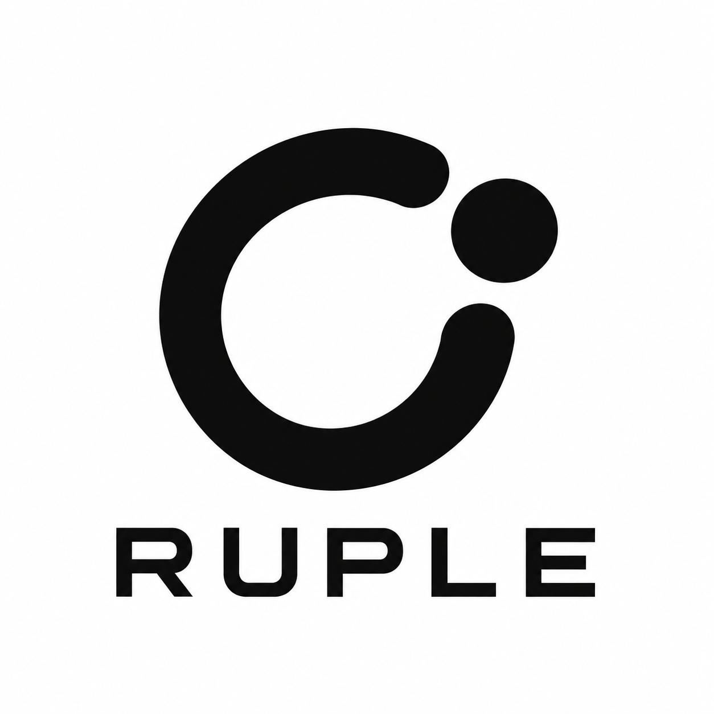

  

# 루플레 (RUPLE)

출퇴근부터 몇 달에 한 번 방문하는 장소까지 챙기는 개인화 모빌리티 루틴 앱을 기획·개발합니다.

반복 방문 이력과 집·회사·즐겨찾기 등 등록 장소를 근거로 이동 루틴을 자동 제안하고, 사용자 승인 후 루틴을 활성화하는 방향을 추구합니다.

## 설계 문서

[1차 프로토타입 범위와 완료 기준](docs/planning/prototype-v1-scope.md)에서 구현·시연 범위, 완료 판정안과 사용자 결정 대기 항목을 관리합니다.

[입출력과 역할 아키텍처](docs/architecture/README.md)에서 차량 앱·스마트폰 앱·서버의 역할, 네 가지 입출력 조합과 전체 흐름을 관리합니다. 현재는 개념 설계 단계이며, 구체적인 차량 기능·권한과 내부 로직은 상세 설계에서 결정합니다.

[기능 모듈과 연결 계약](docs/architecture/functional-modules.md)에서 기능별 책임·상태 소유권·모듈 간 연결을 설계 제안으로 관리합니다.

## 로고

2026년 10월 26일, 프로젝트 대표자가 비교 시안 중 **B안**을 루플레 로고로 선택했습니다.

열린 원형 경로는 반복되는 방문 주기를, 분리된 점은 다음 목적지를 나타냅니다. 매일 반복되는 이동과 오랜 간격을 두고 돌아오는 방문을 함께 기억한다는 의미를 담았습니다.

| 파일 | 구성 및 용도 |
| --- | --- |
| [ruple-logo.png](assets/branding/ruple-logo.png) | 심벌과 RUPLE 이름을 결합한 기본 로고, 흰 배경 |
| [ruple-symbol.png](assets/branding/ruple-symbol.png) | 이름을 제외한 검정 심벌, 투명 배경. 밝은 배경에 사용 |

기본 로고는 이름과 함께 프로젝트를 소개할 때, 심벌은 공간이 작은 화면에서 사용합니다. 로고의 비율과 열린 경로·목적지 점의 관계를 유지합니다.
