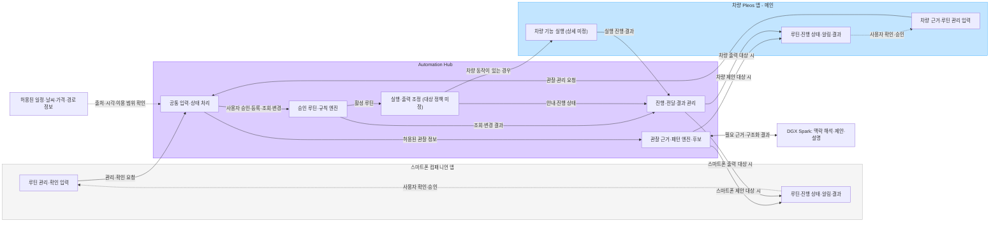
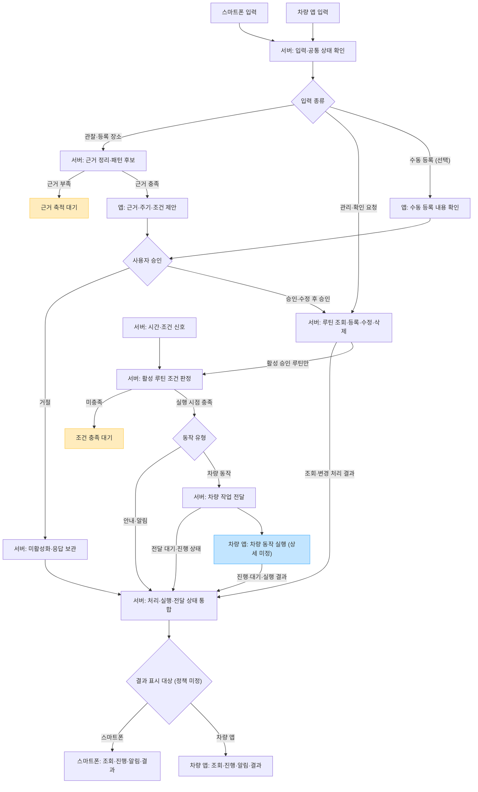

# 루플레 입출력과 역할 아키텍처

루플레는 출퇴근부터 몇 달에 한 번 방문하는 장소까지 챙기는 개인화 모빌리티 루틴 앱입니다. 등록 장소·반복 근거와 차량 관리 상태를 함께 활용하고, 사용자 승인과 개인 선호에 맞춰 다음 이동을 준비합니다.

- 기준일: 2026년 10월 26일
- 근거: 프로젝트 기획 대화, 네 입출력 시나리오와 2026년 10월 26일 진민의 확정·공유 지시
- 설계 단계: 제품 방향·입출력·역할·모듈·진행 기준 확정, 세부 구현 설계 진행
- 확인 범위: 아래 역할과 판단 경계는 확정. 데이터 접근·권한·지원·제품 통합의 실제 검증은 별도

[전체 아키텍처와 제출 개발 계획](../planning/full-architecture-review-2026-10-26.md)에서 상태형 관리·개인화·서버 AI·음성·동적 화면을 포함한 배치도와 작업·시험 기준을 함께 확인할 수 있습니다.

2026년 10월 27일 공유한 [AA·기술 스택 추천안](application-architecture-proposal.md)은 최신 사용자 지정인 Kubernetes·MSA와 모듈별 수직 개발에 맞춰 실행·저장·배포 구성을 제안합니다. 이 문서의 논리 역할은 유지하며 구체 프레임워크와 서비스 배치는 아직 추천 단계입니다. [상세 인계](../handoffs/2026-10-27-project-handoff.md)와 [논의 기록](../meetings/2026-10-27-aa-and-sharing.md)에 변경 관계와 다음 작업을 연결했습니다.

## 기능 모듈 설계

[기능 모듈과 연결 계약](functional-modules.md)에서 이 입출력 흐름을 기능별 책임·상태 소유권으로 구체화합니다. 모듈 책임은 확정했으며 전송·저장 형식과 상세 정책은 후속 설계 사항입니다.

## 기획 방향과 역할

차량 Pleos 앱이 메인이고 스마트폰 앱은 관리·가시화를 담당하는 컴패니언입니다. 두 앱을 엣지 클라이언트(Edge Client), 중앙 서버를 자동화 허브(Automation Hub)로 구성합니다. 사용자는 차량·스마트폰 어디서든 시작할 수 있습니다.

| 구성요소 | 입력 | 출력과 책임 |
| --- | --- | --- |
| 차량 Pleos 앱 | 확보 가능한 차량 근거, 음성·카드·채팅의 사용자 승인·관리·확인 요청 | 주행 상태에 맞는 루틴·진행·알림·결과 표시, 지원되는 차량 동작 실행 |
| 스마트폰 컴패니언 앱 | 허용된 일정·사용자 확인, 음성·카드·채팅의 승인·관리 요청 | 루틴 관리·상세 비교, 진행 상태·알림·결과 표시 |
| 개인 서버 Automation Hub | 두 앱·허용된 외부 정보·시간·조건 신호 | 근거·현재 맥락·후보·승인 루틴, 규칙 판정, 실행·알림·표현 조정 |
| DGX Spark 서버 추론 | 필요한 근거·개인 맥락·계산한 후보·허용 표현 | 소형 언어 모델(SLM)의 맥락 해석·제안·설명. 선택할 음성 추론과 실제 런타임은 별도 검증 |

차량 기능의 실행 책임은 차량 앱에 둡니다. [검증 앱의 내비 요청·취소·화면 전환](../research/pleos-navigation-execution.md)은 확인했으며, 제품의 실제 연동 수준·기능·권한·실차 지원은 상세화와 검증 대상입니다.

## 입력과 출력의 네 조합

입력은 관찰 정보나 사용자 요청이 들어오는 기기이고, 출력은 해당 처리의 결과를 보여주는 기기입니다. 입력 기기도 자기 요청의 처리 여부를 확인할 수 있어야 합니다.

| 입력 기기 | 스마트폰 결과 표시 | 차량 앱 결과 표시 |
| --- | --- | --- |
| 스마트폰 앱 | 스마트폰 입력 후 스마트폰에서 확인 | 스마트폰 입력 후 차량에서 확인 |
| 차량 앱 | 차량 입력 후 스마트폰에서 확인 | 차량 입력 후 차량에서 확인 |

입력 기기와 결과 표시 기기는 독립적으로 구분합니다. 차량 동작이 포함되면 차량 앱이 실행하고, 그 진행·결과를 서버에 보고합니다. 결과 표시 대상이 스마트폰인 경우에도 차량 동작의 실행 주체는 차량 앱입니다. 안내·알림형 루틴은 서버 처리 후 대상 기기로 결과를 전달할 수 있습니다.

같은 루틴 안에서도 단계마다 입출력 조합이 달라질 수 있습니다. 실제 출력 대상 결정 정책은 미정입니다.

## 역할 구성도

상자는 논리적인 책임 구분입니다. 물리적인 배포 구성과 기술 스택은 [AA 추천안](application-architecture-proposal.md)을 검토한 뒤 결정합니다.

## 입력부터 실행 결과까지의 흐름

자동 제안이 기본 경로이며, 수동 등록도 선택 기능으로 제공합니다. 제안은 사용자 확인·수정·승인을 거쳐 루틴으로 활성화합니다. 조회·수정·삭제도 두 앱에서 같은 서버 상태를 기준으로 처리합니다.

패턴 엔진은 근거를 바탕으로 주기·선호·후보를 산출하고, SLM은 계산된 후보와 개인 맥락을 해석해 제안·설명을 구성합니다. 규칙 엔진은 유효한 현재 근거로 승인된 활성 루틴의 조건을 판정합니다. 모델 출력은 후보·근거·대상·허용 동작을 검증한 뒤 사용합니다.

음성·카드·보조 채팅은 같은 명령·후보 버전·실행 상태를 공유합니다. Gen UI는 정의한 컴포넌트를 조합하며 차량과 스마트폰이 각각 표시합니다. 상태형 관리도 알림 확인과 실제 문제 해소를 구분해 다음 판단에 반영합니다.

## 상태를 구분하는 기준

- 목적지 지정 기록, 실제 방문 확인, 패턴 추정, 사용자 승인 구분
- 루틴 저장 완료와 출력 기기 전달 완료 구분
- 차량 작업 전달 대기, 실행 진행, 실행 결과 구분
- 안내 전달·차량 기능 실행 결과와 실제 방문 완료 구분
- 삭제된 루틴은 신규 실행 대상에서 제외

실행 시점은 서버의 시간·조건 판정으로 도래할 수 있습니다. 최초 입력 기기를 다시 실행해야 한다고 전제하지 않습니다. 필요한 데이터나 대상 기기가 연결되지 않은 경우의 처리는 전달·실행 상태로 구분해 상세 설계합니다.

## 상세 설계에서 결정할 사항

- 🚧 동일 사용자 식별·로그인·기기 연결 방식
- 🚧 상황별 제안·알림·결과 출력 대상 결정 정책
- 🚧 실제 확보할 수 있는 차량·내비 데이터의 범위
- 🚧 구체적인 차량 실행 기능, 소프트웨어 개발 도구(SDK) 지원과 권한
- 🚧 제안 기준, 주기 추정, 조건 판정 등 내부 로직
- 🚧 데이터 구조, 인터페이스, 기술 스택과 배포 구성
- 🚧 동의 철회, 데이터 보존·삭제, 통신 중단과 동시 변경 처리 정책

이 문서는 확정한 입출력·역할의 기준입니다. 세부 계약·기술 선택과 미정인 SDK·제품 지원을 구현 가능 또는 검증 완료로 간주하지 않습니다.
