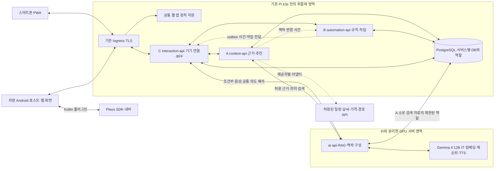

# 루플레 애플리케이션 아키텍처와 기술 스택

모듈별로 화면·서버·저장·시험을 함께 소유하고, Pi의 Kubernetes에 독립 배포하는 마이크로서비스 아키텍처(MSA)를 적용합니다. React·Vite의 웹 앱, NestJS·Fastify의 도메인 서비스, PostgreSQL, 별도 DGX Spark의 FastAPI·LlamaIndex·vLLM과 Gemma 4 12B Instruction Tuned(IT) 조합을 기준 스택으로 확정합니다. 웹 화면을 공유하되 차량 소프트웨어 개발 도구(SDK)는 얇은 Android 브리지에서 호출하는 구성을 우선 검증합니다.

- 분류·목적: 프로젝트. 모듈별 독립 개발과 기존 인프라 재사용에 맞는 실행·데이터·화면·AI 구성을 선택할 수 있게 합니다.
- 기준일: 2026년 10월 26일
- 사용자 지정: Kubernetes·MSA 사용, 모듈별 수직 소유, 빠른 개발, 모바일 웹 허용, 팀 서버 AI와 임베딩·검색 증강 생성(RAG)을 포함한 구성 검토
- 확정: 2026년 10월 27일 사용자가 이 문서의 추천 구성을 채택하고, 멀티모달 주 모델은 Gemma 4 계열로 진행하도록 확인했습니다. 1차 기준 체크포인트는 `google/gemma-4-12B-it`입니다.
- 상태: 애플리케이션 아키텍처와 기준 기술 스택은 확정했습니다. 설치·배포·성능·기기 호환 검증 완료를 뜻하지 않습니다.
- 이어짐: [확정한 제품·모듈·제출 계획](../planning/full-architecture-review-2026-10-26.md), [M1~M6](functional-modules.md), [SDK 검증](../research/pleos-navigation-execution.md)
- 이전 기준과의 관계: 전체 제품 목적과 M1~M6·네 입출력 경로는 유지합니다. 이전의 작은 단일 백엔드 구성 기준은 이 문서의 Kubernetes·MSA 기준으로 대체합니다.
- 변경 범위: AA 확정 문서와 공유·연결 안내. 실제 클러스터·Repair 인프라·제품 코드는 이번 확정으로 변경하지 않습니다.

2026년 10월 27일 사용자의 GitHub 공유 지시에 따라 초안을 [프로젝트 상세 인계](../handoffs/2026-10-27-project-handoff.md)·[논의 기록](../meetings/2026-10-27-aa-and-sharing.md)과 함께 게시했습니다. 같은 날 사용자가 추천 구성을 채택하고 Gemma 4 멀티모달 모델을 우선 적용하도록 확인했으므로 이 문서를 확정본으로 전환했습니다. 확정은 구현 착수 기준을 정한 것이며 실제 배포 완료를 뜻하지 않습니다.

## 기존 인프라를 적용하는 기준

Tramen에서 Raspberry Pi 4노드 k3s `v1.36.5+k3s1` 구축, Argo CD core `v3.5.4`, 네트워크 정책, PostgreSQL 3개, Retain 볼륨, 객체 저장소와 배포 출처·승인 관리 기록을 확인했습니다. 2026년 10월 27일에는 사용자가 라이브 클러스터를 읽기 전용으로 조회했습니다. 네 노드는 모두 `Ready`였고 Argo CD 앱 5개가 `Synced·Healthy`였습니다. 세부 관찰과 한계는 [k3s 실측 기준선](../infrastructure/k3s-baseline-2026-10-27.md)에 분리했습니다. 관련 과거 판단의 v1 그래프에서 번복 표식은 없었습니다.

실측 시점의 네 노드 합계는 16 CPU 코어이고 현재 사용량은 약 321m이었습니다. 할당 가능 메모리는 약 23.3GiB, 현재 사용량은 약 5.7GiB였습니다. `pi-3`과 `pi-4`는 각각 약 7.8GiB 메모리를 제공해 상태 비저장 Ruple 워크로드의 우선 후보입니다. 이 관찰값은 Ruple에 예약된 자원이 아니며 전체 Pod의 requests·limits와 READY·RESTARTS는 배포 전에 추가 확인합니다.

이 실측은 새 클러스터를 다시 만드는 대신 기존 플랫폼에 루플레를 별도 애플리케이션으로 배치할 근거입니다. 저장소는 로컬 RWO이고 확장이 불가능하며, `local-path-retain`도 백업·복원 성공의 증거는 아닙니다. 백업 구조는 정했지만 G3-16 백업 시험과 복원 시험의 완료 기록은 없습니다. Repair의 런타임 예산·DB 권한·운영 정책을 루플레에 그대로 적용하지 않습니다.

루플레용 네임스페이스·접근 권한·리소스 예산과 데이터 저장 범위를 따로 정합니다. 기존 Repair DB·Secret을 기본 연결 대상으로 삼지 않습니다. 클러스터 변경은 기존 Argo CD와 사용자 승인·출처 무결성 절차에 맞춰 수행합니다. ARM64 이미지·GHCR pull·Traefik 라우팅·Ruple 네트워크 정책을 개발 배포 게이트로 두고, 백업·복원 검증은 지속 자료 배치 전 게이트로 둡니다.

## 확정 기술 스택

이 표는 전체 제품의 구현 기준입니다. AI·임베딩·RAG·재순위·음성은 해당 기능을 수행할 때의 구성이고, 11월 15일에는 기존 필수 통합 우선과 대표 확장의 조건부 진행 기준을 유지합니다. 프레임워크를 확정했다고 모든 계층이 제출 필수로 전환되지는 않습니다.

| 영역 | 확정 조합 | 선택 이유·적용 조건 |
| --- | --- | --- |
| 저장소·개발 도구 | pnpm workspace + Nx | 하나의 레포에서 앱·라이브러리·서비스를 구분하고 의존 그래프·생성기·경계 검사를 활용 |
| 공통 웹 화면 | React + Vite + TypeScript | 기능별 화면을 같은 언어·컴포넌트 계약으로 합성, 정적 웹 배포와 차량 포장 검토 |
| 화면 상태·디자인 | TanStack Query, Tailwind CSS + shadcn/ui | 서버 상태 갱신과 공통 디자인 토큰·카드 구현. 실제 차량 규격·WebView 지원 확인 필요 |
| 스마트폰 | 설치형 웹 앱(PWA) | Android·iPhone에서 웹 화면을 먼저 제공. 알림·마이크·설치·백그라운드 제약 별도 시험 |
| 차량 앱 | Capacitor Android 호스트 + Kotlin/Java Pleos 플러그인 | 공통 React 화면과 네이티브 SDK 연결. Pleos에서의 호환성·주행 UX·심사 적합성은 미검증 |
| 업무 서비스 | NestJS + FastifyAdapter + TypeScript | 각 서비스의 모듈·컨트롤러·의존성·인증·오류·계약 생성 방식을 통일 |
| 업무 저장소 | PostgreSQL + Drizzle ORM | 서비스별 데이터 소유·SQL 마이그레이션 관리. DB 주 버전과 ORM·드라이버 호환 확인 |
| 공간·의미 검색 | PostGIS, pgvector | 위치·경로 주변 후보와 텍스트 의미 검색을 각각 처리. 주로 A 서비스 DB에서 사용 |
| 작업 실행·재전달 | PostgreSQL outbox + pg-boss | 승인·실행 계획의 변경과 전달할 사건을 함께 보관하고 비동기 작업 수행 |
| AI 응용 계층 | FastAPI + LlamaIndex | 권한이 있는 자료의 검색·맥락 구성·근거 연결과 추론 API 제공 |
| 멀티모달 생성·이해 | Gemma 4 12B IT | 텍스트·이미지·오디오 입력을 받아 텍스트로 응답. 화면·사진·음성 이해와 구조화 제안에 사용 |
| 생성 추론 | DGX Spark의 vLLM | `google/gemma-4-12B-it`을 내부 OpenAI 호환 추론 엔드포인트로 제공. DGX Spark 컨테이너·지연·동시 처리량 검증 필요 |
| 임베딩·재순위 | 다국어 임베딩 모델, 필요 시 재순위 모델 | 한국어 장소·사용자 표현의 검색 품질을 평가. 모델 실행 환경과 동시 GPU 사용 확인 |
| 배포 | 기존 k3s + Argo CD + Kustomize, ARM64 이미지 | 애플리케이션 단위로 빌드·검증·승인·배포하고 플랫폼 관리 방식 재사용 |

이 조합은 업무 화면과 백엔드를 TypeScript로 맞춰 공통 도구·계약을 공유하기 위한 확정 기준입니다. 실제 팀의 언어 숙련도에 따른 속도 우위는 측정하지 않았습니다. 구현 중 NestJS를 유지할 수 없는 실측 근거가 나오면 같은 서비스·소유권·API 계약을 유지한 채 Go 대안을 변경안으로 검토합니다. Repair에서 Go 작업을 시작한 기록은 루플레의 언어 선택을 바꾸는 근거가 아닙니다.

NestJS는 [FastifyAdapter](https://docs.nestjs.com/techniques/performance)를 공식 지원합니다. 어댑터 선택만으로 Pi 메모리 예산 충족을 보장하지 않으며, Express 전용 미들웨어 대신 호환 패키지를 선택해야 합니다. [Nx 경계 검사](https://nx.dev/docs/features/enforce-module-boundaries)는 TypeScript 프로젝트의 금지된 의존성을 검사하는 데 사용하고, 별도 Python·Kotlin 경계는 계약 시험·빌드 설정으로 관리합니다. 상용 Nx 기능·Nx Cloud를 필수로 두지 않습니다.

## 모듈과 배포 서비스의 대응

M1~M6는 논리 모듈로 유지하고 A·B·C 작업 묶음을 각각 독립 배포 가능한 업무 서비스로 구성합니다. 서비스마다 자신이 소유하는 상태와 화면 기능이 있습니다. API 프로세스·워커·프론트 정적 배포·DB·Ingress 등의 실제 Pod 수는 서비스 수와 다릅니다.

| 작업 묶음 | 배포 서비스 | 논리 모듈·저장 소유 | 화면 소유 |
| --- | --- | --- | --- |
| A 근거·개인 제안 | context-api | M1·M2, 관찰·맥락·패턴·후보·검색 색인 | 근거 확인·루틴 제안·추천 비교 |
| B 루틴·자동화 | automation-api, 필요 시 같은 이미지의 worker | M3·M4, 승인 루틴·버전·조건·실행 계획·알림 정책·outbox/작업 큐 | 승인·수동 CRUD·실행 계획·개인화 알림 설정 |
| C 차량 실행·상호작용 | interaction-api | M5·M6, 사용자·기기 연결·차량 작업 처리·전달·표현·반응 연결 | 실행 진행, 앱 공통 틀, 카드 렌더러·음성·보조 채팅 공통부 |
| A 중심 공통 지원 | ai-api와 추론 런타임 | 검색·임베딩·맥락·모델 호출. 업무 상태를 직접 변경하지 않음 | 각 기능에 설명·구조화 표현 후보 제공 |

interaction-api는 프론트용 집계·중계(BFF)와 기기 연결을 담당합니다. A·B 업무의 승인·규칙·CRUD를 대신 소유하지 않으며, 각 서비스도 사용자·권한·버전·입력을 검증합니다. 화면 담당자는 공통 셸의 정해진 진입점에 자기 기능을 등록하고 자신의 API·저장·시험까지 구현합니다.

프론트는 우선 하나의 웹 앱으로 조립합니다. 각자 화면을 개발할 수 있도록 기능 패키지와 경로를 분리하고, 런타임 마이크로 프론트엔드는 초기 필수로 두지 않습니다. 백엔드는 서비스별 이미지·배포·마이그레이션·API 버전을 관리합니다. 공유 레포가 배포 단일화를 뜻하지는 않습니다.

## 배치와 주요 흐름



그림의 DB 상자는 물리 저장 기반을 묶어 표시합니다. 서비스별 논리 DB·역할·마이그레이션과 소유권은 구분합니다. ai-api의 DB 접근은 A가 소유한 검색 자료와 목적별 허용 역할에 한정하며, 전체 업무 DB를 자유 조회하는 권한을 주지 않습니다. GPU 서버의 접근·엔드포인트·인증·현재 부하는 미검증입니다. 실제 제품 서버 자원 중 k3s에 들어갈 범위와 기존 개인 서버의 역할도 배포 전 확정합니다.

C는 음성 전사·합성·공통 의도 해석을 ai-api에 직접 요청할 수 있습니다. 계약에는 서버가 확인한 사용자·차량·현재 제안/화면 참조·허용 목적·요청 식별·취소와 결과를 포함합니다. A는 추천·RAG 근거의 소유자이며 C의 음성을 대신 중계하지 않습니다. 해석 결과는 C의 공통 명령 검증을 거쳐 A·B·C의 해당 업무로 전달합니다. AI 응답이 곧 승인이나 실행 명령이 되지는 않습니다.

동기 요청은 REST와 OpenAPI를 기준으로 계약을 생성합니다. 화면의 요청은 도메인 명령으로 라우팅하고 사용자에게 제시한 후보·버전·승인 대상을 검증합니다. 비동기 사건은 각 생산 서비스의 DB outbox에서 시작해 상대 서비스 API로 재전달하는 안입니다. 전송 키·소비 기록·만료·재시도를 관리하며, 전달 보장을 차량의 실제 1회 실행 보장으로 확대하지 않습니다.

pg-boss는 B 서비스의 예약·실행 작업에 사용합니다. 루틴별로 Kubernetes CronJob을 생성하지 않고 앱 워커가 승인된 규칙·작업을 처리합니다. 작업 재시도 시에도 현재 루틴 버전·삭제·유효기간·필요 근거·기기 상태를 재확인합니다. A의 맥락 사건과 C의 전달 사건에도 자기 소유의 outbox를 둘 수 있습니다. 별도 메시지 브로커의 필요성은 처리량과 소비자 수를 측정한 뒤 판단합니다.

## 저장 모델과 검색 역할

물리 PostgreSQL 인스턴스를 함께 쓰더라도 A·B·C의 논리 DB와 런타임 역할을 분리합니다. 다른 서비스 DB에 직접 쓰거나 공유 ORM 모델·교차 DB 조인으로 연결하지 않습니다. 읽기 집계는 API 또는 별도 읽기 모델로 구성하고, 업무 변경은 소유 서비스가 처리합니다. Ruple 전용 인스턴스인지 기존 플랫폼의 별도 DB인지, 저장 볼륨·백업·확장 설치 권한은 운영 자원을 확인한 뒤 결정합니다.

| 자료 | 저장·판단 방식 | 주요 소유 |
| --- | --- | --- |
| 위치·시간·차량 상태·방문 근거 | 관계형·시계열 관찰과 출처·신선도, 필요한 공간 검색 | A |
| 패턴·선호·후보 | 구조화 결과와 근거 참조·버전·불확실성 | A |
| 승인 루틴·실행 계획·알림 정책 | 관계형 상태·트랜잭션·작업 큐 | B |
| 기기·차량 작업·전달 상태 | 요청·시도·처리·확인·미확인을 구분 | C |
| 사용자 표현·허용된 요약·설명 자료 | 원문/요약의 출처·이용 범위·버전과 벡터 색인 | A와 제한된 AI 검색 역할 |

[PostGIS](https://postgis.net/documentation/)는 위치 관계·경로 주변 후보에 활용하고 [pgvector](https://github.com/pgvector/pgvector)는 의미 유사도 검색에 활용합니다. 실제 지도 매칭·길찾기·교통 예상시간은 별도 알고리즘·제공자 검증이 필요합니다. 확장 이름만으로 해당 기능을 확보한 것으로 처리하지 않습니다. ARM64 이미지에 PostgreSQL 주 버전·두 확장의 호환 조합을 검증합니다.

DB 마이그레이션은 각 소유자의 SQL 변경을 검토하고 기존 플랫폼의 배포 전 Job·승인 방식과 연결합니다. 인증 비밀·실제 연결 문자열은 운영 비밀 관리 경로에서 주입하고 공개 레포나 모델 입력에 넣지 않습니다.

## Gemma 4 멀티모달 모델과 RAG를 포함한 AI 구성

AI 응용 계층에는 Gemma 4 생성·이해 모델, 임베딩, 검색, 맥락 구성, 선택한 재순위, 출력 검증을 분리해 둡니다. Gemma 4 12B IT는 텍스트·이미지·오디오 입력과 텍스트 출력을 담당합니다. 음성 합성은 제공하지 않으므로 음성 출력용 TTS는 별도 교체 가능한 제공자로 연결합니다. 통계·수치 계산·규칙 판정은 기존 M2·M4의 프로그램이 수행합니다.

1. **자료 준비:** 허용된 텍스트·사용자 명시 선호·패턴 요약을 정규화하고 출처·사용자·차량·목적·유효기간·버전을 부착합니다.
2. **임베딩·색인:** 필요한 문서·요약만 비동기로 벡터화합니다. 위치 좌표나 모든 센서 표본을 바로 텍스트로 바꿔 모델에 계속 보내지 않습니다.
3. **검색:** 계정·차량·동의·목적·최신 버전을 필터링한 뒤 SQL 조회와 의미 검색을 조합합니다. 검색 결과와 프롬프트의 허용 범위를 다시 확인합니다.
4. **재순위·맥락 구성:** 필요한 경우 후보 문서의 순위를 재평가하고, 확정 사실·추정·계산 후보·누락 정보를 구분해 모델에 제공합니다.
5. **제안·검증:** 생성 모델이 후보 ID·근거·설명·확인 항목·표현 계획을 반환하면 서버가 이를 검증하고 사용자에게 제시합니다.
6. **변경·철회 반영:** 원문·요약·벡터·검색 결과·캐시의 버전과 이용 범위를 함께 갱신합니다. 삭제·동의 철회 후 검색에 남지 않는지 시험합니다.

정확한 잔량·주기·현재 위치·실행 상태는 SQL과 해당 제공자의 최신 자료를 사용합니다. RAG에는 관련 근거를 찾는 역할을 부여하며, 실제 상태를 모델이 대신 확정하지 않습니다. 자료가 부족한 사용자는 명시적 설정과 기본 규칙으로 처리하고 모델 출력의 근거 부족을 표시합니다.

[LlamaIndex RAG](https://developers.llamaindex.ai/python/framework/understanding/rag/)는 수집·색인·검색·맥락 구성·평가를 연결하는 응용 프레임워크로 사용합니다. 모델 제공자는 자체 호스팅 Gemma 4 엔드포인트로 명시적으로 구성하며 예제의 외부 기본 제공자를 그대로 사용하지 않습니다. [NVIDIA의 DGX vLLM 절차](https://build.nvidia.com/playbooks/vllm)와 [vLLM 지원 모델 목록](https://docs.vllm.ai/en/latest/models/supported_models/)을 기준으로 배치하되 실제 DGX Spark 컨테이너·한국어 출력·지연·동시 처리량은 따로 검증합니다.

생성·멀티모달 이해의 기준 모델은 [Gemma 4 12B IT](https://ai.google.dev/gemma/docs/core/model_card_4)로 확정합니다. 이 모델은 텍스트·이미지·오디오를 입력받아 텍스트로 응답하며, 영상은 프레임 열로 처리합니다. 모델 체크포인트와 입력 형식은 고정하되 최대 문맥·이미지 토큰 예산·오디오 길이·동시 요청 수는 루플레 시험값으로 조정합니다. 개발·저자원 대체가 필요하면 같은 Gemma 4 계열의 E4B IT를 사용할 수 있지만, 1차 품질 판정은 12B IT를 기준으로 합니다.

Gemma 4는 벡터 임베딩 모델이 아니므로 RAG 색인에는 별도 임베딩 모델을 둡니다. 초기 후보인 [Qwen3-Embedding-0.6B](https://huggingface.co/Qwen/Qwen3-Embedding-0.6B)는 유지하되 한국어 장소 검색 품질과 DGX 환경의 속도를 검증한 뒤 확정합니다. 재순위 모델과 음성 합성 모델도 별도 선택 대상입니다. 음성 입력은 Gemma 4 12B의 직접 오디오 이해를 우선 시험하고, 지연이나 정확도가 기준을 못 채우면 전용 STT를 앞단에 둡니다. 큰 모델을 선택하는 것을 개인화 품질의 근거로 삼지 않습니다.

## 웹 앱과 차량 앱의 경계

스마트폰은 PWA를 우선 추천합니다. 화면·카드·채팅·동의한 일정 연결·서버 상태 조회를 웹으로 구성하고, 설치·알림·마이크·네트워크 복구를 기기에서 시험합니다. 서버의 예약 작업이 알림 시점을 관리하며 브라우저 타이머나 백그라운드 WebSocket의 지속 동작을 전제로 두지 않습니다.

iPhone 웹 푸시는 [WebKit 안내](https://webkit.org/blog/13878/)의 홈 화면 설치·사용자 동작에 따른 권한 요청 등의 조건을 확인해야 합니다. SSE·WebSocket은 전경의 갱신 채널로 사용하고, 앱이 닫힌 때에는 허용된 푸시 경로를 이용합니다. 푸시·화면 전달 성공과 루틴·차량 실행 성공은 구분합니다.

차량은 일반 PWA만으로 NaviHelper를 직접 호출할 수 있다고 전제하지 않습니다. [Capacitor 플러그인](https://capacitorjs.com/docs/plugins)은 웹과 Android 네이티브 코드를 연결할 수 있으므로, 번들한 신뢰 화면과 제한된 Pleos 플러그인을 우선 검증하는 후보입니다. 차량 호스트에 PWA 서비스워커를 동일하게 적용하지 않고 별도 빌드·배포 대상으로 관리합니다.

네이티브 브리지는 지원할 메서드와 인자만 노출하고, 현재 대상 차량·사용자 승인·요청 기한·중복을 확인하는 M5 실행 경계를 유지합니다. 임의 웹 페이지나 생성된 스크립트가 SDK를 자유 호출하는 구조를 두지 않습니다.

필수 호환 시험은 APK 설치, WebView·Vite 출력 지원, SDK 초기화·조회·내비 요청·콜백, 화면 전환, 앱 일시 중단·재개, 오디오·마이크·주행 제한(UXR)입니다. 일반 Android에서의 브리지 지원이 Pleos 심사·주행 허용을 보장하지 않습니다. 임의 웹 탐색을 제공하는 브라우저 앱과 제품 내부 화면 호스팅의 구분도 심사 기준으로 확인합니다.

차량 웹 호스트가 검증을 통과하지 못하면 차량 UI는 Kotlin·Compose로 구성하고, 폰 웹과 데이터·명령·표현 계약·디자인 토큰을 공유하는 대안을 둡니다. 이 경우 화면 코드 공유 범위와 공수를 다시 산정합니다. 원격시동·새로운 차량 제어·시동 OFF·프로세스 종료 뒤 실행은 기존대로 미검증입니다.

## 기능별 작업 경계와 레포 구조

```text
apps/
  web/                    공통 웹 앱 셸
  car/                    Android 호스트·Pleos 플러그인
  context-api/            A 서비스 진입점
  automation-api/         B 서비스 진입점
  automation-worker/      B 작업 실행 진입점
  interaction-api/        C 서비스·BFF 진입점
  ai-api/                 Python AI 응용 계층
packages/
  context/{ui,contracts,server}/
  automation/{ui,contracts,server}/
  interaction/{ui,contracts,server}/
  presentation/           컴포넌트 목록·검증·렌더러
  platform/               공통 명령·인증 연결·시각·관찰성
  platform-client/        브라우저 API·Query·캐시 경계
  platform-server/        Node HTTP·설정·인증 연결·로그·OpenAPI
infra/development/        로컬 PostgreSQL·초기 역할·이미지 고정
infra/k8s/                향후 기본 매니페스트·환경별 오버레이
```

2026년 10월 29일 모노레포·최소 앱 골격·공통 HTTP·프론트 기반을 위 구조에 반영했습니다. 로컬 DB·Drizzle 기술 예제·계약 기반 모의 서버를 추가했으며 업무 로직·업무 DB 모델·실제 AI 연결은 후속이고 apps/car는 호환 시험 전 경계만 둡니다. A·B·C는 자기 UI와 서비스·SQL·계약·시험을 함께 변경합니다. 웹 앱은 기능별 진입점으로 조립하고 API 클라이언트는 앱이 주입합니다. 브라우저·서버 공통 코드는 platform-client와 platform-server로 분리했습니다. 다른 서비스의 내부·ORM 모델을 직접 import하지 않도록 Nx가 검사하며, 서비스 연동은 공개 계약을 사용합니다.

Gen UI의 컴포넌트·허용 동작·후보 버전은 공통 계약으로 관리합니다. 기능 담당자가 내용과 화면을 소유하고 C가 공통 표현·음성·전달을 지원하는 기존 원칙을 유지합니다. 승인 버튼·음성 응답은 현재 표시한 대상과 버전을 참조해야 하며, 생성된 UI가 차량 동작을 직접 호출하지 않습니다.

## 실행 자원과 검증 순서

로컬에서는 각 서비스·화면을 계약 기반 시험 응답과 함께 실행하고, ARM64 이미지와 통합 경로는 기존 k3s에서 검증하는 구성을 권합니다. CI는 기능별 검사·이미지 빌드·계약 호환 검사를 수행하고, 승인한 이미지 다이제스트와 배포 선언을 Argo CD가 반영하도록 합니다. 실제 자동 동기화·서명·승인 정책은 기존 플랫폼 기준에 맞춥니다.

공통 시작 템플릿에는 설정 검증·인증 연결·오류 형식·요청 추적·준비/종료 처리·OpenAPI·시험 자료를 포함합니다. 서비스별 독립 개발이 서로 다른 기본 규약으로 갈라지지 않도록 이 틀을 먼저 맞춥니다. MSA 전환에는 이미지·배포·서비스 간 오류·마이그레이션·계약 호환 검증 작업이 추가되므로 기존 가용량을 그대로 기능 개발 시간으로 계산하지 않습니다. 이 추천만으로 11월 15일의 전체 확장 완료를 보장하지 않습니다.

| 순서 | 확인할 내용 | 실패할 때 조정 |
| --- | --- | --- |
| AA 실행 전제 | 현재 노드 여유·저장소·네트워크·기존 Ingress/Argo 정책·DGX 접근 | 승인한 자원 예산 안에서 배치·프로세스·DB 방식 조정 |
| 차량 웹 호스트 | 공유 웹 카드와 Pleos 초기화·조회·내비·콜백·화면·재개 | 차량 네이티브 UI 대안과 공수 재산정 |
| 업무 최소 통합 | A 시험 근거·후보, B 승인 저장, C 양쪽 전달·선택한 차량 실행 수준 | 공통 계약·상태 소유·재전달 오류 해결 |
| 지속 작업 | 예약·수정·삭제·중복·오프라인·재연결·워커 재시작 | outbox·작업 키·기한·재판정 보완 |
| AI 검색·생성 | Gemma 4 12B IT의 텍스트·이미지·오디오 입력, 사용자 분리·검색 근거·구조화 출력·한국어 품질·지연·메모리 | 문맥·멀티모달 예산·동시 요청 조정, 필요 시 Gemma 4 E4B 개발 대체와 전용 STT 적용 |
| PWA·음성 | 홈 화면 설치·권한·푸시·마이크·취소·오디오 간섭 | 채널별 지원·미지원과 대체 입력 표시 |

확정한 프레임워크 조합을 실제 서버·기기에서 통합 실행한 결과는 아직 없습니다. 다음 단계에서는 팀 개발 환경을 맞추고, 차량 호스트·DGX Spark의 Gemma 4 12B IT·k3s 배치 전제를 작은 호환 검증으로 확인합니다. 11월 15일의 기존 필수 통합과 조건부 확장 구분은 유지합니다.

## 근거

Tramen의 D-infra-1/Pi ARM k3s 전환 기록(2026년 9월 8일), Pi k3s 후속·Argo CD 첫 배포 기록(10월 9일), G3-13 PostgreSQL 구축 및 D-infra-18/19 저장·배포 정책 기록(10월 13일)을 조회했습니다. 기록에 있는 내부 주소·비밀·서명 식별자는 이 문서에 옮기지 않았습니다.

- [K3s 환경 요구사항](https://docs.k3s.io/installation/requirements)
- [Nx 모노레포](https://nx.dev/docs/kb/what-is-a-monorepo), [모듈 경계](https://nx.dev/docs/features/enforce-module-boundaries)
- [Vite](https://vite.dev/guide/), [TanStack Query](https://tanstack.com/query/latest/docs/framework/react/overview), [shadcn/ui 모노레포](https://ui.shadcn.com/docs/monorepo)
- [NestJS FastifyAdapter](https://docs.nestjs.com/techniques/performance), [Drizzle](https://orm.drizzle.team/docs/overview), [pg-boss](https://github.com/timgit/pg-boss)
- [PostGIS](https://postgis.net/documentation/), [pgvector](https://github.com/pgvector/pgvector)
- [Capacitor 네이티브 플러그인](https://capacitorjs.com/docs/plugins), [iOS 웹 푸시](https://webkit.org/blog/13878/)
- [FastAPI](https://fastapi.tiangolo.com/), [LlamaIndex RAG](https://developers.llamaindex.ai/python/framework/understanding/rag/), [Gemma 4 모델 카드](https://ai.google.dev/gemma/docs/core/model_card_4), [Gemma 4 모델 개요](https://ai.google.dev/gemma/docs/core), [vLLM Gemma 4 지원](https://docs.vllm.ai/en/latest/models/supported_models/), [DGX vLLM](https://build.nvidia.com/playbooks/vllm), [임베딩 후보](https://huggingface.co/Qwen/Qwen3-Embedding-0.6B)

## 공통 프레젠테이션 디자인 기준

2026-10-29 사용자 요청으로 공통 디자인 기준을 Pleos Connect UI Design Guide에 맞췄습니다. RUPLE 브랜드와 React·Tailwind·Radix 기반을 유지하며 색상·폰트·상태·주야간 테마를 공통 패키지에서 제공합니다. 구체적인 토큰 대응·출처·호스트 검증 한계는 [Pleos 기준 공통 디자인](../development/pleos-design-system.md)을 따릅니다. 업무 화면의 정책과 실제 주행 규제·차량 호스트 적합성은 별도 설계·검증 대상입니다.
