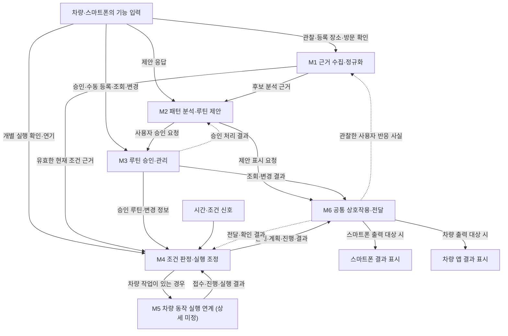

# 루플레 기능 모듈과 연결 계약

자동 제안부터 승인된 루틴의 실행과 결과 표시까지, 각 상태를 어느 모듈이 관리하고 어떤 정보로 다음 단계에 연결할지 정리합니다.

- 기준일: 2026년 10월 26일
- 기획 기준: [입출력과 역할 아키텍처](README.md)
- 상태: 2026년 10월 26일 진민이 기능 모듈·상태 소유권·판단 경계를 확정. 세부 계약 형식은 상세화 대상
- 범위: 논리 모듈과 정보 전달 관계
- 미정: 담당자, 물리 배포, 기술 스택, 내부 알고리즘, 구체적인 차량 기능·권한

[전체 아키텍처와 제출 개발 계획](../planning/full-architecture-review-2026-10-26.md)에 상태형 관리·개인화·서버 AI·음성·동적 화면, A·B·C 작업 묶음과 진행 기준을 함께 정리했습니다. 확정은 설계 기준이며 실제 구현·SDK 지원의 완료 판정과 구분합니다.

## 모듈을 나누는 기준

차량 앱·스마트폰 앱·서버는 실행 위치입니다. 기능 모듈은 그 위치를 가로질러 화면·서버 처리·저장·기기 연계에 필요한 책임을 묶습니다.

자동 제안이 기본이며 수동 등록은 선택 기능입니다. 관찰 근거, 추정 후보, 사용자 승인 루틴, 실행 기록과 전달 기록을 구분합니다. 각 상태의 변경은 그 상태를 소유한 모듈의 계약을 거칩니다.

입력 기기, 차량 동작의 실행 대상, 결과를 표시할 기기는 각각 구분합니다. 스마트폰이 결과 표시 대상이어도 차량 동작이 포함되면 차량 앱의 실행 경계를 거칩니다.

## 기능 모듈

| 모듈 | 책임 | 소유하는 상태 | 다음 모듈로 전달할 정보 |
| --- | --- | --- | --- |
| M1 근거 수집·정규화 | 허용된 차량·모바일·외부 관찰·등록·사용자 확인을 수집하고 출처·시각·이용 범위·최신성을 정리 | 관찰·등록·확인 근거, 자료 상태와 현재 맥락 | M2의 후보 분석 근거, M4의 조건 판정 근거 |
| M2 패턴 분석·루틴 제안 | 반복·주기·선호 분석과 수치 비교, 서버 소형 언어 모델(SLM)의 맥락 해석·후보·설명, 제안 응답 관리 | 추정 패턴·후보·근거, 제안·거절·수정 응답, 승인 루틴 참조 | M6의 제안 표시 요청, M3의 사용자 승인 요청 |
| M3 루틴 승인·관리 | 이동형·상태형 후보 승인과 수동 등록, 조회·수정·삭제, 승인 정의·버전 관리 | 승인 루틴, 사용자 확정 조건, 변경 기준값·이력 | M4의 루틴 상태·변경 정보, M6의 관리 결과, M2의 승인 처리 결과 |
| M4 조건 판정·실행 조정 | 승인 루틴과 유효한 현재 근거·시간으로 판정하고 실행 건·연기·중복·재알림·만료를 관리 | 실행 계획·실행 건·알림 정책 적용 결과, 진행·대기·결과와 루틴 버전 | M5의 차량 작업 요청, M6의 안내·알림·실행 상태 |
| M5 차량 동작 실행 연계 | 서버의 차량 작업을 차량 앱에 연결하고 진행·결과를 수집 | 차량 앱의 동작 처리 상태와 실행 보고 | M4의 차량 작업 접수·진행·실행 결과 |
| M6 공통 상호작용·전달 | 음성·카드·보조 채팅의 공통 입출력, 기기별 렌더링·알림·진행 표시와 전달 | 출력 대상 결정 결과, 전달·확인 상태, 표시용 상태와 표현 참조 | 양쪽 앱의 표시·사용자 반응을 기능별 처리부로 전달 |

M1의 관찰 정보를 M2가 바꾸거나, M2의 추정 후보가 M3의 승인 루틴을 직접 바꾸지 않도록 구분합니다. M6의 전달 완료도 M4·M5의 차량 동작 완료와 구분합니다.

M5의 구체적인 제품 동작·소프트웨어 개발 도구(SDK)·권한은 개별 결정·검증 대상입니다. [검증 앱의 내비 실행 결과](../research/pleos-navigation-execution.md)는 확보했으며, 제품 흐름의 연동 수준과 실차 지원은 별도입니다.

개인 서버 Automation Hub와 DGX Spark의 추론 자원을 사용합니다. M2의 통계·수치 계산·SLM 호출, M4의 승인된 규칙 판정, M5의 차량 실행을 분리합니다. 모델이 승인 루틴을 직접 변경하거나 실행 성공을 확정하지 않습니다. 개인화는 관련 근거와 프로필 조회부터 구성하며 사용자별 모델 재학습을 필수로 두지 않습니다.

## 각 실행 위치에서 맡을 부분

| 모듈 | 차량 앱 | 스마트폰 앱 | Automation Hub |
| --- | --- | --- | --- |
| M1 | 확보 가능한 차량 근거의 입력 연계, 근거·방문·관리 해소 확인 | 사용자 확인·허용된 일정 입력, 근거·연결 상태 확인 | 근거·현재 맥락, 외부 제공자 연계, 출처·최신성·허용된 보관 범위 관리 |
| M2 | 후보 카드·근거 확인·제안 응답 화면 | 후보 카드·근거 확인·제안 응답 화면 | 통계·패턴·SLM 호출과 결과 검증, 후보·응답 관리 |
| M3 | 승인·수동 등록·조회·수정·삭제 화면 | 승인·수동 등록·조회·수정·삭제 화면 | 승인 루틴과 변경 관리 |
| M4 | 방문 준비 내용·실행 계획 확인 | 방문 준비 내용·실행 계획 확인 | 규칙 엔진, 조건 판정, 실행 계획·상태 관리 |
| M5 | 차량 동작의 실행 경계, 필요한 실행 확인, 진행·결과 수집 | 차량 작업의 진행·결과를 M6에서 확인 | 차량 작업 전달·보고 수신 연계, M4로 결과 전달 |
| M6 | 주행 상태에 맞는 공통 카드·음성·알림·진행 표시 | 상세 카드·관리·음성·보조 채팅·알림 표시 | 공통 요청·표현 연결, 출력 대상 결정, 전달·확인 상태 제공 |

각 기능 담당자가 해당 기능의 화면부터 서버·저장·연계까지 맡는 방식입니다. M6가 모든 기능 화면을 전담하지 않습니다. 후보 화면은 M2, 루틴 편집 화면은 M3처럼 기능별로 소유하고, M6는 전달과 공통 진행·결과 표시를 담당합니다.

실행 위치가 하나인 부분도 기능의 입출력 계약까지 함께 검토합니다. M5는 차량 앱의 실행 경계와 서버의 전달·보고 연계를 묶되, 전체 실행 건의 상태 변경은 M4에 맡깁니다.

## 모듈 연결도

아래 화살표는 주요 정보 전달 관계입니다. 함수 호출, 애플리케이션 프로그래밍 인터페이스(API), 메시지 등 실제 구현 방식은 추후 결정합니다. 별도 서버나 저장소의 배포 구성을 뜻하지 않습니다.

앱의 직접 조회는 기능별 상태를 소유한 모듈의 조회 계약으로 연결합니다. 루틴 조회는 M3, 제안 조회·응답은 M2, 실행 진행·결과의 표시용 조회는 M6가 제공합니다. M6의 표시용 상태는 M4·M5가 보고한 실행 상태를 반영합니다.

## 주요 연결 계약

계약 이름과 항목은 의미를 맞추기 위한 초안입니다. 전송 형식·저장 스키마·인터페이스 경로는 아직 정하지 않습니다.

| 계약 | 생산·요청 측 | 수신 측 | 포함해야 할 의미 |
| --- | --- | --- | --- |
| 근거 묶음 `EvidenceContext` | M1 | M2·M4 | 출처·관찰/수신 시각·이용 범위, 값 있음·확인된 부재·조회 실패·오래됨·미지원, 관찰·등록·사용자 확인과 근거 참조 |
| 개인 패턴 `PersonalPattern` | M2 | 후보 분석·설명 구성 | 분석 구간·근거량·불확실성, 추정 주기·선호, 사용자 명시 설정과 추정 구분 |
| 제안 내용 `RoutineProposal` | M2 | M6·제안 화면 | 후보 ID·버전, 장소 또는 상태형 대상, 근거 참조, 추정 주기·조건, 확인할 항목 |
| 공통 사용자 명령 `UserCommand` | 음성·카드·채팅 수신부 | 해당 상태를 소유한 M2·M3·M4 | 사용자·기기·차량·대상 ID·버전·요청 식별·중복 방지 키, 사용자가 본 승인 내용 |
| 루틴 승인·등록 요청 `ApproveOrCreateRoutine` | M2의 승인 흐름 또는 M3의 직접 등록 화면 | M3 | 사용자 승인 내용, 후보 참조가 있으면 해당 참조, 사용자가 수정·확정한 조건 |
| 루틴 상태·변경 정보 `RoutineStateChanged` | M3 | M4 | 루틴 식별, 승인·변경 기준, 활성 여부, 생성·수정·삭제의 결과 |
| 승인 처리 결과 `RoutineApprovalResult` | M3 | M2·요청 화면 | 처리 성공 여부, 연결된 루틴 참조, 실패·충돌 시 확인할 상태 |
| 차량 작업 요청 `VehicleActionRequest` | M4 | M5 | 실행 건·루틴 버전·현재 근거·개별 실행 승인 참조·유효기간, 동작·실행 대상 차량 |
| 차량 작업 보고 `VehicleActionReport` | M5 | M4 | 같은 실행 건의 접수·진행·대기·실행 결과, 확인할 수 있는 실제 상태의 범위 |
| 출력 요청·상태 갱신 `PresentationRequest` | M2·M3·M4 | M6 | 표시할 내용, 관련 후보·루틴·실행 참조, 전달할 상태, 출력 대상 결정에 필요한 맥락 |
| 표현 계획 `PresentationPlan` | 기능별 처리부·표현 구성 | M6·양쪽 클라이언트 | 컴포넌트·데이터·허용 동작 ID, 제안·화면 버전, 음성 요약, 미지원 시 기본 표현 |
| 전달·확인 결과 `DeliveryReceipt` | M6 | 요청 모듈·M4 | 출력 대상 기기, 전달·미전달·사용자 확인의 구분, 관련 처리 건 |
| 사용자 반응·해소 근거 `UserFeedback` | 기능 처리부·관찰 수신부 | M1·해당 기능 | 열람·승인·거절·연기·사용자 완료 확인·관찰된 문제 해소를 구분, 대상·버전·출처·시각 |

공통으로 같은 사용자·기기와 처리 건을 식별할 수 있어야 합니다. 후보가 아직 루틴이 되지 않은 단계에서는 후보 참조를 쓰고, 실행 건에는 어떤 루틴 상태를 기준으로 했는지 연결합니다. 식별 방식과 로그인·기기 연결 정책은 미정입니다.

입력 기기에는 자기 요청의 접수·처리 결과를 반환합니다. 다른 기기로 전달할 제안·표시 결과는 M6의 전달 상태와 별도로 관리합니다. 저장 완료를 다른 기기 전달 완료로 표시하지 않습니다.

## 연결 시나리오

### 자동 제안과 승인

1. 어느 앱에서 확보한 허용 근거든 M1이 출처와 의미를 정리합니다.
2. M2가 근거를 검토해 후보를 만듭니다. 근거 부족 시 추가 정보를 기다리며, 제안 기준은 상세 설계에서 결정합니다.
3. M6가 대상 앱에 제안을 전달하고, M2의 후보 화면에서 사용자가 근거·주기·조건을 확인합니다.
4. 사용자가 승인하거나 수정 후 승인하면 M3가 승인된 루틴을 등록합니다.
5. M3는 처리 결과를 반환하고 M2는 성공한 승인에 연결된 루틴 참조를 남깁니다. 등록 실패를 승인 완료로 표시하지 않습니다.
6. M4는 승인된 활성 루틴과 현재 근거를 바탕으로 다음 실행을 준비합니다.

수동 등록은 M3의 등록 화면에서 사용자 확인 후 M3로 연결합니다. M1·M2의 패턴 분석을 기다리는 조건을 두지 않습니다.

### 수정과 삭제

수정·삭제 요청은 M3가 처리합니다. M4는 그 변경을 받아 기존 실행 계획을 최신 루틴 상태에 맞춰 재검토하고, M6는 갱신된 관리·표시 결과를 전달합니다.

삭제된 루틴은 신규 실행 대상으로 삼지 않습니다. 이미 전달하거나 시작한 차량 작업을 취소할 수 있는 범위와 동시 변경 처리는 상세 설계에서 결정합니다. 삭제한 루틴의 동일 근거 재제안 정책도 미정입니다.

### 실행과 결과

안내·알림형 동작은 M4가 실행 건을 관리하고 M6에 출력을 요청합니다. 차량 동작이 포함되면 M4가 M5에 차량 작업을 요청하고, M5가 진행·결과를 M4에 보고합니다. M6는 그 상태를 대상 앱에 표시합니다.

출력 대상 선택 정책과 실제 차량 동작·승인·권한은 아직 정하지 않습니다. 차량 작업 전달 대기, 차량 동작의 진행·결과, 화면·알림 전달을 구분합니다.

| 입력과 결과 표시 조합 | 차량 동작이 포함된 실행 경로 |
| --- | --- |
| 스마트폰 입력·스마트폰 표시 | 스마트폰 입력을 처리한 뒤 M4가 M5에 차량 작업을 요청하고, M4가 받은 진행·결과를 M6가 스마트폰에 표시 |
| 스마트폰 입력·차량 표시 | 스마트폰 입력을 처리한 뒤 M4가 M5에 차량 작업을 요청하고, M6가 차량 앱에 진행·결과 표시 |
| 차량 입력·스마트폰 표시 | 차량 입력을 처리한 뒤 M4가 M5에 차량 작업을 요청하고, M6가 스마트폰에 진행·결과 표시 |
| 차량 입력·차량 표시 | 차량 입력을 처리한 뒤 M4가 M5에 차량 작업을 요청하고, M6가 차량 앱에 진행·결과 표시 |

같은 차량 앱에서 입력·실행·표시가 이루어져도 루틴 정의와 전체 실행 상태는 서버의 소유 모듈을 기준으로 구분합니다. 자동 실행은 새 앱 입력 없이 서버의 시간·조건 신호로 시작할 수도 있습니다.

실제 방문 여부는 실행 결과와 별도로 확인합니다. 사용자가 확인한 방문 사실은 M1의 근거로 남겨 이후 후보 분석과 조건 판정에 연결합니다.

상태형 관리도 알림·열람·내비 요청과 실제 주유·정비·문제 해소를 구분합니다. 해소 근거를 M1에 반영해 다음 판정에 사용하며, 원본 저장·서버 전송은 공급자와 사용자의 허용 범위 안에서 수행합니다. 음성·생성 카드가 해석한 요청도 공통 명령과 버전·승인 검증을 거칩니다.

## 공통 경계

사용자·기기 연결, 동의·이용 범위, 공통 식별, 오류·상태 표현은 모듈들이 공유할 계약입니다. 이를 별도 배포 서비스로 구성할지는 미정입니다.

| 경계 | 이번 단계의 책임 | 미정 사항 |
| --- | --- | --- |
| 사용자·기기·동의 | 각 입력과 상태가 어느 사용자·기기·이용 범위에 속하는지 전달 | 로그인·페어링 방식, 동의 화면·정책 |
| 상태 변경 | 소유 모듈의 계약으로 조회·변경하고 관련 처리 건을 연결 | 저장 스키마, 트랜잭션·동시 변경 처리 |
| 출력 대상 | M6가 제안·상태·결과의 표시·알림 대상 결정과 전달을 담당 | 상황별 대상·채널 선택과 대체 전달 정책 |
| 차량 실행 대상 | M4·M5가 차량 동작의 실행 대상과 결과를 연결 | 구체 기능, 동작 승인, SDK·권한·실행 제약 |
| 데이터 이용 중단 | 허용되지 않은 근거의 수집·이용과 그 근거에 의존한 처리를 구분 | 철회·보존·삭제 범위와 실행 재평가 정책 |

출력 대상 결정과 차량 실행 대상 결정은 각각의 경계에서 다룹니다. 연결되지 않은 기기로 전달하거나 실행할 수 있다고 간주하지 않습니다.

## 협업과 다음 설계

모듈별 담당자가 자기 기능의 화면·서버·저장·기기 연계를 함께 맡습니다. A는 M1·M2, B는 M3·M4, C는 M5·M6를 중심으로 작업을 묶습니다. 담당 실명·풀타임 배정·개별 공수는 미정입니다. 진민의 아키텍처·화면 명세·통합 검토 시간도 가용 시간에 포함합니다.

진민이 공통 흐름과 계약·화면 명세를 주도하고, 각 모듈 담당자가 계약을 기준으로 기능을 구현합니다. 서로 다른 모듈의 상태를 직접 변경하는 연결은 소유 모듈의 요청·결과 계약으로 정리합니다.

확인한 API·제약과 [전체 개발 계획](../planning/full-architecture-review-2026-10-26.md)을 기준으로 전체 구조를 유지하고, [1차 필수 범위](../planning/prototype-v1-scope.md)와 조건부 확장에 맞춰 요구사항·세부 계약·공수를 구체화합니다. 계약·환경 확인과 작은 통합 흐름을 병행한 뒤 기능 폭을 늘립니다. 구체 차량 기능·권한과 상세 알고리즘은 별도로 결정·검증합니다.
