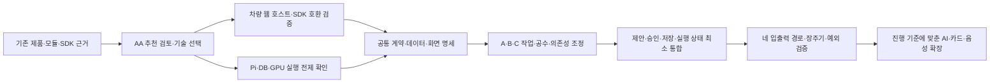

# AA 검토와 팀 공유 기록 (2026-10-27)

모듈별로 화면·서버·저장·시험을 함께 개발할 수 있도록 Kubernetes 기반 마이크로서비스 아키텍처(MSA)를 검토하고, 기술 추천안과 전체 인계를 팀이 읽을 수 있게 공유합니다. 제품 방향·필수 기능은 기존 기준을 유지하며 프레임워크와 실제 배포 선택은 아직 추천 단계입니다.

- 분류·목적: 프로젝트. 대화에서 나온 요구·추천·검증 결과를 구분해 팀원과 다음 세션이 같은 근거로 AA 검토를 이어가게 합니다.
- 기록 범위: 10월 26일 작성한 AA 추천과 그 전제가 된 대화, 10월 27일 상세 인계·공유 요청까지의 논의입니다. 날짜를 붙인 추진 계획을 실제 완료 이력으로 옮기지 않습니다.
- 출처: 프로젝트 대표자의 요청·답변, [기존 공유 기준](../planning/full-architecture-review-2026-10-26.md), [AA 추천안](../architecture/application-architecture-proposal.md), Tramen 상세 인계 원문, 이번 게시 전 Git 상태입니다.
- 확인 상태: 사용자의 요구·공유 지시는 확인했습니다. 아래 기술 조합과 상세 정책은 별도 결정 대상입니다. 문서 작성·검토가 사용자 확인이나 제품 실행 시험을 대신하지 않습니다.
- 형식: 대화의 요구·판단·미정 사항을 정리한 기록입니다. 자동 생성된 질문·추천을 사용자 결정으로 바꾸지 않습니다.

## 대화에서 확인한 요구와 해석

| 논의 | 사용자 요구·확인 내용 | 이번 반영과 상태 |
| --- | --- | --- |
| 설계 순서 | 모듈 세부 명세·입출력 계약 전에 DB·백엔드·프론트엔드·서버를 포함한 AA가 필요 | 실행·저장·배포·화면 기술 추천을 먼저 제시하고 상세 계약으로 연결 |
| 대표 시나리오 | 출퇴근·몇 달 주기 방문·상태형 관리 등은 이미 설명 | 기존 사례에서 명세·시험을 도출. 시나리오 자체를 처음부터 다시 요구하지 않음 |
| 개발 분담 | 분야별 분업보다 모듈별 수직 개발, 각자가 화면도 구현 | A·B·C가 자신의 화면·API·데이터·시험을 소유. M6는 모든 화면의 전담자가 아님 |
| 빠른 클라이언트 개발 | 모바일은 네이티브 필수가 아니며 웹 앱도 가능 | React 웹·PWA 추천. 차량 SDK는 별도 Android 브리지 호환성 검증 필요 |
| 서버 구성 | 기존 Raspberry Pi 5 Kubernetes를 활용한 MSA 희망 | 기존 k3s·Argo CD 운영 기준을 재사용하는 서비스 배치 제안. 실제 배포는 미수행 |
| AI 배치·기능 | 팀 운영 서버와 DGX Spark, 생성 모델 외 임베딩·RAG 등 고려 | AI 응용·검색·추론·음성을 분리. 모델·GPU 성능·실제 연결은 미선정·미검증 |
| 인계 | 지금까지 내용을 Tramen에 상세 기록해 다른 세션에서 바로 시작 | 상세 메모 저장 후 원문 재조회 일치와 제한 검색 성공 확인 |
| 공개 공유 | AA 초안과 오늘 대화·기록 모두 GitHub에 공유 | AA·상세 인계·이 논의 기록, README와 기존 기준 문서의 연결 안내 포함 |

공유 요청은 위 기술 조합의 선정이나 차량 권한·실차 지원·배포 성공을 일괄 승인한 것으로 해석하지 않습니다. 새로운 비전·정책·공수·완료 기준이 필요한 자리는 대표자에게 확인합니다.

## AA 추천 구성

| 계층 | 추천 | 상태 |
| --- | --- | --- |
| 레포·화면 | pnpm·Nx, React·Vite·TypeScript, TanStack Query, Tailwind·shadcn/ui | 추천, 제품 스캐폴딩 미생성 |
| 클라이언트 | 스마트폰 PWA, 차량 Capacitor Android 호스트+Kotlin/Java Pleos 플러그인 | 추천, 차량 웹 호스트·푸시·오디오 검증 필요 |
| 업무 서비스 | A context-api(M1·M2), B automation-api/worker(M3·M4), C interaction-api(M5·M6) | NestJS·Fastify 추천, 실제 서비스 미구축 |
| 저장·작업 | PostgreSQL·Drizzle, PostGIS·pgvector, outbox·pg-boss | 서비스별 데이터 소유, 물리 DB·호환·자원·운영 방식 미정 |
| AI | FastAPI·LlamaIndex, 별도 GPU 추론 런타임 vLLM 후보 | 임베딩·검색·맥락·구조화 생성·검증, 음성 어댑터 분리 |
| 배포 | 기존 k3s·Argo CD·Kustomize, ARM64 이미지 | 사용자 지정 MSA 방향에 맞춘 추천, 클러스터 변경 미수행 |

공유 웹 앱 안에서 기능별 화면 패키지를 조립합니다. 독립 백엔드 서비스와 런타임 마이크로 프론트엔드 도입은 별개이며 후자는 초기 필수가 아닙니다. 논리 M1~M6와 물리 배포 프로세스·Pod 개수를 같게 고정하지 않습니다.

검색 증강 생성(RAG)은 허용된 관련 근거를 찾는 역할입니다. 현재 잔량·위치·실행 상태·주기 계산은 SQL·현재 관찰·프로그램을 기준으로 판단합니다. 사용자·차량·동의·목적·버전 범위를 검색 전에 제한하고 철회·삭제를 원문·요약·벡터·캐시에 반영합니다. 생성 모델은 확인된 후보·행동만 제안하며 업무 상태나 차량 SDK를 직접 변경하지 않습니다.

C는 음성·공통 의도 해석을 AI API에 직접 요청할 수 있고, A는 추천·RAG 근거를 소유합니다. 모든 음성을 A에 중계하지 않습니다. 해석된 요청은 동일한 명령·사용자·후보 버전 검증을 거칩니다.

## 기존 기준과 변경 관계

| 항목 | 유지·변경 관계 |
| --- | --- |
| 핵심 가치 | 출퇴근부터 몇 달 간격의 방문까지 자동 제안·준비·알림, 승인 후 활성화 유지 |
| 입출력·역할 | 두 Edge Client와 Automation Hub, 네 경로 유지. 차량 동작의 실행 주체는 차량 앱 |
| 논리 책임 | M1~M6와 A·B·C의 수직 소유 유지 |
| 초기 배포 방향 | 과거 작은 단일 백엔드 기준은 최신 Kubernetes·MSA 요청에 따라 변경 대상. 구체 서비스 경계·스택은 추천 |
| 제출 범위 | 기존 필수 통합 우선·조건부 확장 유지. AI·RAG·음성을 논의했다는 이유로 모두 필수 완료로 전환하지 않음 |
| 실제 구현 | 기존 probe의 에뮬레이터 검증 유지. 새 서버·PWA·차량 웹 호스트·AI·배포를 구현한 상태는 아님 |

## 오늘 확인한 공유 준비 상태

게시 전 `master`와 `origin/master` 및 GitHub `master`는 `5e1322f7ddc32addb3c4a6ecb0ff3f5a9d988409`였습니다. AA 문서만 로컬 미추적 상태였고, 기존 코드에는 변경이 없었습니다. 이번 공유에는 해당 AA 문서와 공개 인계·논의 기록을 포함합니다.

Tramen 원문은 독립 검토 후 저장했습니다. SDK 결과의 사용자 확인 상태와 Gleo의 ‘앱 등록 함수 최대 3개’ 표현을 보완했고 저장 후 본문 일치를 확인했습니다. 이번 공개본은 개인 절대 경로·기록 식별자를 제외하고 AA 게시 상태와 진입점을 갱신했습니다. Tramen 계정이나 개인 메모 링크 없이도 레포 문서로 이어갈 수 있습니다.

문서 검토는 링크·상태·근거·민감정보와 기존 기록의 정합을 확인하는 작업입니다. SDK 재실행·새 모델 실행·클러스터 시험을 수행한 것으로 보고하지 않습니다.

## 미정 사항과 재개 순서

🚧 프레임워크 선정, 팀 언어 경험·실명 배정, 우선 모바일 기기, 현재 Pi/GPU 자원, 차량 웹 호스트 호환, 알림·제안·보관·동의 정책, 1차 실제 차량 연동 수준은 남아 있습니다. 값이 비어 있다는 이유로 임의 기본값을 만들지 않습니다.

[상세 인계](../handoffs/2026-10-27-project-handoff.md)의 제품·권한·시험·일정·미정 목록과 [AA 추천안](../architecture/application-architecture-proposal.md)의 구성도를 읽고 이어갑니다. 레포 문서 게시와 실제 운영 배포·공모전 접수는 별도 작업입니다.
