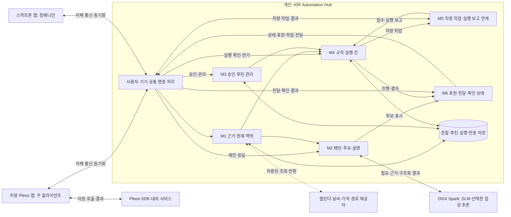
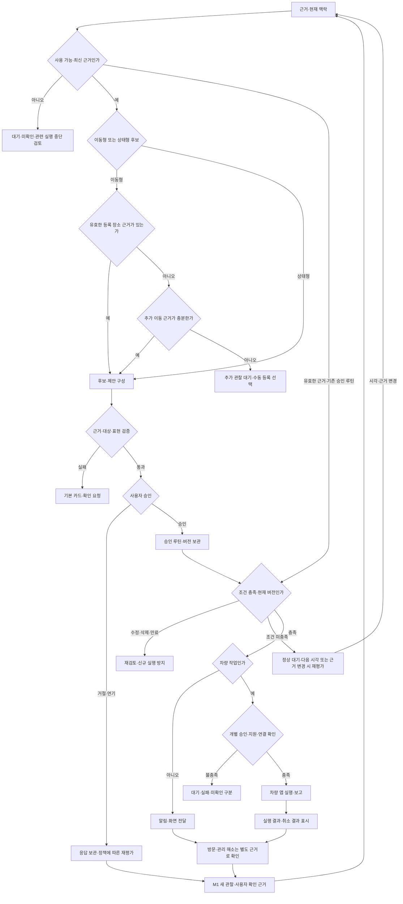

# 루플레 전체 아키텍처와 제출 개발 계획

2026년 11월 15일 제출을 목표로, 기존 필수 루틴 기능을 네 입출력 경로에서 연결하고 서버 인공지능(AI)·음성·동적 화면의 대표 흐름을 조건부 확장 목표로 추진합니다. 전체 제품의 확장 범위와 제출 전 구현 범위를 구분하며, 새로운 소프트웨어 개발 도구(SDK)·외부 서비스 연동은 개별 검증 결과에 따라 반영합니다.

- 분류와 목적: 프로젝트. 전체 제품안, 모듈 책임, 제출 전 개발 순서와 시험 자원을 연결해 담당자가 구현할 범위를 판단할 수 있게 합니다.
- 기준일: 2026년 10월 26일, 한국 표준시
- 이어지는 기준: [입출력 아키텍처](../architecture/README.md), [기능 모듈](../architecture/functional-modules.md), [1차 범위](prototype-v1-scope.md), [초기 제안 정책](../requirements/initial-routine-proposal.md), [API 대응표](../research/pleos-data-api-matrix.md)
- 상태와 변경 영향: 2026년 10월 26일 진민의 확정·공유 지시에 따라 제품·아키텍처·개발 진행 기준으로 채택했습니다. 기존 정본과 연결해 상태를 갱신하며, 실제 제품 코드·검증 결과·담당 실명은 변경하지 않습니다.
- 진민 확인: 제품 방향, M1~M6의 책임과 판단 경계, A·B·C 작업 묶음, 필수 통합 우선과 조건부 확장, 날짜별 진행 기준을 확정했습니다. 담당 실명·우선 모바일 시험 기기·차량 연동 수준·기존 사례의 시험 명세·세부 계약은 추가 결정 대상입니다. 기술 선택은 10월 27일 [AA 확정본](../architecture/application-architecture.md)으로 후속 확정했습니다.
- 독립 검토: 기존 문서·공식 자료를 대상으로 구조, 개발 계획, SDK 제약을 각각 검토했습니다. 이 검토는 새 제품 실행 시험이나 사용자의 완료 확인을 대신하지 않습니다.

> 2026년 10월 27일 후속 확정: 기존 Pi Kubernetes를 활용한 MSA와 모듈별 화면·서버·저장·시험의 수직 개발을 적용합니다. 아래 초기 단일 백엔드 기준은 [AA 확정본](../architecture/application-architecture.md)의 서비스·프레임워크·DB·Gemma 4 멀티모달 구성으로 대체합니다. 제품·M1~M6·네 경로·필수 통합과 조건부 확장의 구분은 유지합니다. 대표 시나리오는 이미 제시됐으며 남은 것은 시험 입력·기대 결과·상세 정책입니다. [상세 인계](../handoffs/2026-10-27-project-handoff.md)와 [논의 기록](../meetings/2026-10-27-aa-and-sharing.md)에서 변경 이력을 확인할 수 있습니다.

## 확정 근거와 남은 확인 범위

| 구분 | 확인한 내용 | 판단에 미치는 영향 |
| --- | --- | --- |
| 사용자 지정 | 제출 마감 11월 15일. 팀 1명 풀타임, 직장인 2명은 각 하루 최대 4시간 | 가용 일수와 풀타임의 하루 시간은 별도 산정 가정 필요 |
| 사용자 지정 | 개인 서버·DGX Spark 사용, Android·iPhone 시험 기기 사용 가능 | 보유 사실과 실제 접속·설치·모델 실행을 구분 |
| 기존 1차 확정 | 자동 제안, 승인·수동 등록, 조회·수정·삭제, 장주기 알림, 진행·결과 표시, 네 입출력 경로 | 이번 검토에서 필수 기능을 축소하지 않음 |
| 기존 검증 조건 | 시험 데이터로 흐름 검증 가능. 차량 측 에뮬레이터 충분 | 실제 수개월 주행·실차·전체 외부 API가 제출의 선행 조건은 아님 |
| 최신 제품 방향 | 상태형 관리와 이동 루틴 통합, 개인별 알림 조정, 캘린더·날씨·가격·개인 경로 활용 | 전체 제품안의 입력·판단·결과 범위에 포함 |
| 최신 AI·상호작용 방향 | 팀 서버의 소형 언어 모델(SLM), 음성, 카드 중심 생성형 사용자 인터페이스(Gen UI), 보조 채팅 | 전체 제품에 포함. 제출에서는 대표 흐름의 조건부 목표로 관리 |
| 이번 확정 | 현재까지 정리한 제품·모듈·협업·진행 기준을 확정하고 GitHub에 공유하도록 진민이 지시 | 미정 사항과 실제 검증 상태를 확정으로 바꾸지 않음 |
| 실제 구현 | 즐겨찾기·최근 목적지 조회, 내비 요청·취소·전경 화면·상태 조회 검증 앱 | 제품 서버·스마트폰·루틴 엔진의 통합 완료와 구분 |

[공식 공고](https://appdevchallenge.auto-hmg.io/notice/c0a1a000-2026-4923-8000-000000000001)는 11월 15일 접수 마감, 기획서 필수, 개발 산출물 선택·가산점을 안내합니다. 목업·프로토타입·화면 녹화도 인정하므로 제품 전체를 완성해야 개발 산출물을 제출할 수 있는 조건은 아닙니다. 접수 종료 시각과 최종 제출 형식은 제출 준비 때 다시 확인합니다.

확정 전 검토의 기준은 위 정본, Git 기준 `690dfdc`, 검증 앱·실행 요약, 필요한 공식 문서입니다. 실제 개인 서버·DGX 접속, 모델·음성 추론, 사용자 스마트폰 설치, 새 SDK 호출, 제품 전체 통합, 실차·마켓 심사는 이번 검토의 미검증 범위입니다. 저장소는 검토 시작 시 변경이 없었습니다.

## 전체 제품과 제출 목표

전체 제품은 개인의 이동 의도와 실제 관찰, 차량 관리 필요 상태를 축적하고, 승인된 규칙과 개인 선호에 맞춰 이동 준비·추천·알림·실행을 연결합니다. 몇 달 간격의 방문을 기억하는 가치를 계속 중심에 둡니다.

| 제품 영역 | 전체 제품 범위 | 제출 전 목표 | 후속으로 검증할 범위 |
| --- | --- | --- | --- |
| 이동 루틴 | 등록 장소·반복 근거에서 단기·중기·장주기 루틴 제안 | 근거 충족·부족, 승인·거절·수정 후 승인, 수동 등록, 전체 관리 | 실제 개인 이력의 장기간 학습·정확도 |
| 상태형 관리 | 연료·배터리·워셔액·저압·정비·문·창문·공조 준비 | 대표 상태 한 종류로 공통 템플릿의 판정·알림·해소 흐름 검증 | 모든 상태의 실연동, 제조사 기준·차종별 지원, 원격 제어 |
| 일정·경로 | 캘린더 일정, 익숙한 길과 과거 소요시간, 경유지 유사 경로 | 시험 일정과 장소, 출처가 구분된 경로 후보, 승인 후 내비 요청 | 실제 캘린더·지오코딩, 연속 위치 축적, 경유지 재현 정도 |
| 주유·충전 | 가격·경로·시간·선호를 반영한 제안 | 대표 주유 제안 사례에 갱신 시각과 시험 출처 표시 | 오피넷·경로 API 실연동, 우회비용, 충전기 상태·호환성 |
| 개인화 | 방문·주유·선택·연기·거절을 바탕으로 시점·빈도 조정 | 명시적 선호와 응답으로 재알림·중복 정책 재현 | 지속 학습, 개인별 성과, 집단 추천 |
| 서버 AI | 통계·계산 결과와 맥락을 받아 제안·설명 구성 | DGX에서 실제 모델을 호출하는 대표 구조화 제안 목표 | 모델별 품질·비용 최적화, 별도 재학습 |
| 음성·화면 | 음성·카드·채팅으로 동일한 기능 조작 | 제한된 카드 목록, 보조 텍스트 입력, 대표 음성 요청·확인 | 자유 대화, 다양한 카드 자동 구성, Gleo 정식 연동·주행 UX |

표의 제출 확장은 조건부 목표로 확정합니다. 기존 필수 통합이 늦어지면 확장 개발을 멈추고 진민에게 범위·일정 영향을 보고합니다. 확장 제외를 전체 제품 비전의 폐기로 처리하지 않습니다.

## 개인화 데이터의 장기 확장

개인의 이동 목적·주기·일정·선호 경로·차량 관리·사용자 응답을 출처와 함께 연결하는 개인화 이동 맥락 데이터 계층(Mobility Context)을 장기 방향으로 유지합니다. 초기에는 근거와 명시적 설정을 활용하고, 허용된 관찰이 쌓이면 제안 시점·대상·알림 정책을 정교화합니다. 관찰·추정·사용자 확인은 계속 구분합니다.

제조사가 향후 권한과 연동 범위를 확대하면 차량 에너지 관리와 자율주행 개인화 데이터의 연계를 검토합니다. 현재 센서·카메라·파워트레인 제어·자율주행 권한을 확보했다는 의미는 아닙니다. 집단 추천은 별도 동의와 이용 범위를 전제로 하며, 장소 대체 추천·광고는 장기 사업 확장으로 구분합니다. 해당 기능을 11월 15일 제출 필수로 포함하지 않습니다.

## 실행 환경과 배치 기준

차량 앱과 스마트폰 앱은 에지 클라이언트이며, 개인 서버의 중앙 애플리케이션 서버(Automation Hub)가 사용자·루틴·실행 상태의 기준을 관리합니다. DGX Spark는 서버 측 Gemma 4 멀티모달 추론 기능을 제공합니다. 10월 26일 당시에는 백엔드와 관계형 저장소를 작게 구성하고 배포 서비스·저장소를 모듈 수만큼 분리하지 않는 초기안을 두었습니다. 이 초기안은 10월 27일 [AA 확정본](../architecture/application-architecture.md)의 Kubernetes·MSA 구성으로 대체했습니다.



위 연결은 기능 관계이며 통신 방식이나 DB 물리 분할의 확정이 아닙니다. 차량 동작을 포함하면 실제 SDK 호출은 차량 앱이 수행합니다. 스마트폰이 결과 표시 대상이어도 이 경계는 유지합니다. 차량 미연결·오래된 정보·서버 추론 실패를 별도 상태로 표시합니다.

## 기능 모듈과 책임

기존 M1~M6를 유지하고 다음 책임·소유권을 기준으로 상세 계약을 보완합니다. 모듈은 기능의 상태 소유권이며, 사람·서버·저장소와 일대일 대응하지 않습니다.

| 모듈 | 확장 책임과 소유 상태 | 입력과 출력 | 맡기지 않을 판단 |
| --- | --- | --- | --- |
| M1 근거·맥락 | 차량·모바일·외부 관찰, 출처·시각·이용 범위·신선도, 현재 맥락 | 수집 어댑터·사용자 확인을 받아 근거·맥락 제공 | 추정을 실제 방문·주유·정비 완료로 확정 |
| M2 개인화·제안 | 반복·주기·선호 추정, 추천 후보, SLM 해석·설명, 제안 응답 | M1·루틴 참조·응답을 받아 근거가 붙은 후보 제공 | 승인 루틴 직접 변경, 차량 상태·권한 창작 |
| M3 루틴 관리 | 이동형·상태형 템플릿의 승인 정의, 생성·조회·수정·삭제·이력 | 사용자 명령과 후보를 받아 버전이 있는 루틴 제공 | 실행 성공·방문 완료를 루틴 저장으로 판정 |
| M4 자동화·알림 정책 | 시간·상태 조건, 실행 계획·실행 건, 반복 알림·연기·중복·만료 | 승인 정의·현재 근거·시각을 받아 작업·표시 요청 제공 | SLM 문장을 실행 조건으로 직접 사용 |
| M5 차량 실행 | 지원 기능·연결 확인, 명령 전달, 차량 처리 보고 | 실행 건·승인 대상·인자를 받아 접수·진행·성공·실패·미확인 보고 | 내비 요청 성공을 도착·관리 완료로 판정 |
| M6 공통 상호작용·전달 | 채널별 전달, 표시 상태, 음성·카드·채팅의 공통 입출력 연결 | 기능별 표시 내용과 사용자 반응을 전달 | 모든 화면·도메인 상태를 소유하거나 생성 UI에서 직접 실행 |

M2 안에서도 통계·패턴 분석, 수치·제약 비교, SLM 추론 호출을 구분합니다. 소요시간·가격·잔량 계산은 근거가 있는 프로그램이 수행하고, SLM은 후보·개인 맥락의 해석과 설명에 활용합니다. 모델이 개인별로 매번 재학습해야 한다는 전제를 두지 않습니다.

공통으로 제공할 구성은 사용자·기기 연결, 이용 범위, 명령 식별·중복 방지, 시각 제공, SDK 연결 수명주기, 추론 어댑터, 컴포넌트 목록·렌더러, 로그·시험 도구입니다. 각 기능 담당자가 자기 화면·서버·저장·어댑터·시험까지 소유하고, M6는 공통 표현과 전달을 지원합니다.

### 연결 계약의 상세화 항목

아래 항목은 의미를 정의하는 초안이며 최종 JSON·DB 스키마는 아닙니다.

| 계약 | 관리 주체 | 추가할 의미 |
| --- | --- | --- |
| 근거·현재 맥락 | M1 | 출처·관찰/수신 시각, 값 있음·확인된 부재·조회 실패·오래됨·미지원, 동의·이용 범위, 근거 참조 |
| 개인 패턴 | M2 | 분석 구간·근거, 추정 주기·선호, 근거량·불확실성, 사용자 명시 설정과 추정의 구분 |
| 제안·변경 후보 | M2 | 후보 ID·버전·대상 장소/상태, 사용한 근거, 확인할 항목, 허용 후보 참조 |
| 사용자 명령 | 공통 수신부와 해당 기능 | 사용자·기기·차량·대상 ID·버전·요청 ID·중복 방지 키, 사용자가 본 승인 내용 |
| 승인 루틴 | M3 | 승인한 주기·조건·활성 범위, 이동형/상태형, 변경·삭제 이력 |
| 실행 건·차량 작업 | M4·M5 | 루틴 버전·현재 근거·개별 동작 승인 참조·유효기간, 요청·접수·실행·미확인·취소 결과 |
| 표현 계획 | 각 기능과 M6 | 컴포넌트·데이터·허용 동작 ID, 대상·화면 버전, 짧은 음성 요약, 미지원 시 기본 카드 |
| 사용자 반응·해소 근거 | 기능 처리부와 M1 | 전달·열람·승인·거절·연기·사용자 완료 확인·관찰된 상태 해소를 각각 구분 |

시스템 제공 상태형 템플릿의 활성 방식은 🚧 미정입니다. 루틴 정의 승인과 개별 내비·차량 동작의 승인은 별도 의미로 연결합니다. 알림 확인을 문제 해소로 처리하지 않고, 실제 해소를 확인하면 다음 판정 기준을 갱신합니다.

### 오류와 변경 분기



이동형 후보의 분기는 초기 등록 장소 정책을 표현합니다. 등록 정보가 있어도 주기를 확정하지 않으며, 개별 캘린더 일정의 이동 준비와 반복 루틴의 추정 근거는 구분합니다. 상태형 후보는 시스템 제공 템플릿·활성 범위·판정 근거를 함께 검토합니다. 수동 등록은 근거 부족 상태를 포함해 모든 상태에서 선택할 수 있고, 사용자 확인을 거쳐 M3에 등록합니다.

추가 분기는 중복 승인·중복 전달, 승인 중 후보 갱신, 실행 직전 수정·삭제, 통신 중단 후 재연결, 인자 누락, 늦게 도착한 SDK 이벤트, 동의 철회, 취소 요청을 받았지만 실제 취소를 확인하지 못한 경우입니다. 재시도 횟수·보존 기간·취소 가능 시점은 상세 명세에서 정합니다.

## AI와 음성 및 동적 화면

SLM에는 필요한 근거·프로필·이미 계산한 후보와 허용 컴포넌트를 전달합니다. 출력은 후보 ID·근거 참조·설명·추가 확인 사항·표현 계획으로 제한합니다. 서버가 후보 존재·수치·권한·최신 버전을 검증하고, 모델만 실패한 경우 승인된 기본 규칙과 고정 카드가 계속 동작하도록 합니다. 서버나 차량까지 오프라인인 상황의 처리와는 별개입니다.

음성·터치·채팅은 같은 도메인 명령을 사용합니다. "첫 번째 곳"·"그건 다음에"는 현재 제안 ID·버전과 연결해야 합니다. 화면을 생성했다는 사실이나 음성 인식 성공을 사용자 승인·차량 실행 완료로 간주하지 않습니다.

Gen UI는 미리 구현한 카드·비교·확인·진행 컴포넌트를 조합합니다. 차량 주행 중에는 핵심 조작 위치와 간단한 확인을 유지하고, 상세 편집·풍부한 비교는 정차 또는 스마트폰 경험으로 구분합니다. 실제 주행 제한(UXR) 상태를 받지 못했을 때의 기본 정책은 🚧 미정이며, 정차 시연을 주행 허용 검증으로 확대하지 않습니다.

[Gleo 문서](https://document.pleos.ai/en/docs/pleos-only/app-integration-guide/guide/app-capability)는 앱 등록 함수 최대 3개를 안내합니다. [스키마 승인](https://document.pleos.ai/en/docs/pleos-only/app-integration-guide/guide/deliver-schema)이 필요한 경로이므로, 제출 일정의 핵심 의존성으로 두지 않습니다. 자체 음성은 음성 인식·합성과 SLM을 교체 가능한 어댑터로 구분하고, 마이크·한글 장소명·취소·무음·지연·내비 음성 간섭을 시험합니다. 상시 청취·호출어·운전대 버튼·차내 마이크 접근은 미검증입니다.

[Android A2UI](https://developer.android.com/develop/ui/compose/agentic)는 선언형 컴포넌트 목록·검증·네이티브 렌더링의 참고 구현입니다. 채택·SDK 호환·iOS 렌더링을 확인한 상태는 아닙니다. [Pleos UI 지침](https://document.pleos.ai/en/docs/connect/guide/docs-design/Introduction/intro)을 차량 컴포넌트와 음성 출력의 기준으로 적용해야 합니다.

## 세 명의 작업 묶음과 진행 방식

아래는 기능 모듈별 수직 소유를 유지하도록 확정한 작업 묶음입니다. 담당 실명과 풀타임 담당자가 누구인지는 미정입니다. 진민의 아키텍처·화면 명세·통합 검토 시간도 본인의 가용 시간 안에 포함해야 합니다.

| 작업 묶음 | 주요 책임 | 담당자가 끝까지 만들 부분 | 의존 계약 |
| --- | --- | --- | --- |
| A 근거와 개인 제안 | M1·M2, 추론 연계 | 시험 자료·수집 어댑터, 근거·패턴·후보, 제안 화면, SLM 입력·출력·실패 시험 | 사용자·기기, SDK 연결, 후보·표현 계획 |
| B 루틴과 자동화 | M3·M4 | 승인·수동 CRUD 화면, 저장·버전, 시험 시각, 조건·실행 건·알림 정책, 수정·삭제·중복 시험 | 공통 명령, 근거, 차량 요청·전달 상태 |
| C 차량 실행과 공통 상호작용 | M5·M6, 앱 공통 틀 | 차량 실행·보고, 양쪽 앱 전달·렌더링, 공통 명령 연결, 음성 어댑터, 미연결·표현 실패 시험 | 공통 명령·실행·표현·반응 계약 |

양쪽 클라이언트와 SDK를 연결하는 C를 풀타임 담당 배정 때 우선 검토하는 기준을 둡니다. 실제 배정은 미정입니다. A·B의 작업량이나 팀 경험에 따라 배정은 조정해야 합니다. 특정 분야를 한 사람에게만 맡기거나 풀타임 담당자를 진민이라고 가정하지 않습니다.

작업 묶음은 업무량을 영구 고정하는 단위가 아닙니다. 각 모듈의 주 담당자는 유지하되, 공통 틀·자료·검토 지원을 배분할 수 있습니다. C에 도메인별 제안·편집 화면까지 모두 넘기지 않습니다. SDK 연결 같은 공통 파일은 소유자를 정하고, 기능별 패키지·시험 자료·화면 파일을 나눠 병렬 변경의 충돌을 줄입니다.

진행 순서는 공통 계약과 실제 실행 환경을 먼저 맞추고, 가장 작은 입력·제안·승인·실행·표시를 연결한 뒤 기능 폭을 늘립니다. 공유 상태는 그 상태를 소유한 모듈의 계약으로만 변경합니다. 인지하지 못한 브랜치·파일을 일괄 커밋하지 않습니다.

### 작업분류체계와 선행 조건

작업분류체계(WBS)의 추진 항목과 선행 조건은 다음 기준을 따릅니다. 개별 예상 시간은 아직 산정하지 않았습니다.

| 작업 | 산출물과 완료 조건안 | 주 담당 묶음 | 선행 조건 |
| --- | --- | --- | --- |
| W00 제품·범위·계약 | 제출 범위, 기존 사례의 시험 입력·기대 결과, 화면 상태, 명령·근거·실행 계약을 대조할 수 있음 | 진민 주도·전원 검토 | 이번에 확정한 진행 기준과 남은 상세 결정 |
| W01 공통 실행 틀 | 차량·선택한 폰 앱·서버에서 같은 시험 사용자·기기·요청을 식별하고 저장·조회·표시 | C, 각 기능 연결은 A·B | 서버 접근·우선 모바일 OS·공통 계약 |
| W02 시험 자료·입력 | 등록 장소 있음/없음, 자료 실패·부재, 장주기·상태 변화 자료를 재현 | A | 근거 계약·시험 모드 표시 |
| W03 후보·제안 | 근거 충족·부족 비교, 후보 이유·주기 확인, 거절·수정 후 승인 진입 | A | W01·W02 |
| W04 루틴 관리 | 자동 제안 승인과 수동 생성, 조회·수정·삭제 및 다른 기기 반영 | B | W01·후보·버전 계약 |
| W05 조건·알림 | 필수: 시험 시각·장주기·진행 상태. 확장 채택 시 상태형 대표·개인화 알림·해소 재현 | B | W02·W04·전달 계약 |
| W06 차량 실행 | Q03에서 선택한 수준의 요청·진행·결과 연결. 실제 SDK 내비 요청·화면·취소는 채택 시 수행 | C | W01·실행 계약·Q03. 실제 연동 채택 시 기존 probe 근거 활용 |
| W07 카드·텍스트 입력 | 기본: 제안·관리·진행 표시와 공통 동작. 확장 채택 시 생성형 카드·텍스트 대화·미지원 표현 처리 | C, 기능 내용은 A·B | 표현 계약·기기별 제한 |
| W08 서버 SLM | Spark 실제 호출, 구조화 후보·근거 검증, 모델 실패 기본 동작 | A | DGX 접근·런타임·W03·W07 |
| W09 대표 음성 | 제한된 요청·확인을 같은 명령에 연결, 취소·오인식·무음 처리 | C | 마이크·음성 엔진·W06·W07 |
| W10 통합·복구 시험 | 필수: 네 경로·승인·관리·장주기·진행·선택한 차량 수준. 확장 포함 시 모델·음성·생성 화면 실패도 대조 | 전원, 작성자 외 검토 | W03·W04·W05 필수·W07 기본·Q03에서 선택한 W06 수준. 채택한 확장 작업 추가 |
| W11 제출 자료 | 기획서의 구현·미검증 표기, 실행 안내·영상·허용된 산출물 | 진민 주도·기능별 증거 제공 | W10·공개/제출 조건 확인 |

## 가용량과 날짜별 진행 기준

사용자 확인은 1명 풀타임과 2명 각 하루 최대 4시간입니다. 풀타임 하루 8시간, 주 5일, 10월 27일~11월 13일에 모두 최대 시간을 투입한다고 가정하면 14개 평일, 합계 224인시입니다. 이는 112·56·56인시의 산정 상한이며, 실제 투입 약속·기능별 공수·완료 가능성을 입증하는 값이 아닙니다. 명세·학습·검토·통합·시험·제출 준비가 모두 이 안에서 시간을 사용합니다.

[산정 결과](../research/results/planning-capacity-2026-10-26.json)는 [재현 스크립트](../../scripts/planning_review.py)로 산출합니다. 10월 26일의 잔여 시간과 주말 추가 작업은 합계에 넣지 않았습니다. 평일 근무 가능 여부·풀타임 실제 시간·휴가·학습 부담은 🚧 미확인입니다.

| 판정일 | 확인할 결과 | 미통과 시 조치 |
| --- | --- | --- |
| 10월 28일 | 대표 시연·모바일 우선 OS·모듈 책임·공통 계약, 서버/DGX 접근, 에뮬레이터 재기동 확인 | 외부 API·음성·화면 확장보다 계약·환경 문제 해결 |
| 11월 2일 | 두 클라이언트와 서버의 최소 제안·승인·저장·대상 표시. 차량 부분은 Q03 선택 수준의 요청·결과 연결 | 확장 착수 중단, 통합 병목과 범위 영향 보고 |
| 11월 6일 | 기존 필수 기능 정상 흐름·장주기 재현. 확장을 채택했다면 상태형 대표도 별도 확인 | 필수와 확장 결과를 구분해 공수 재산정. 필수 누락은 일정 위험 보고 |
| 11월 9일 | 네 경로, 중복·삭제·미연결 처리. 준비된 경우 SLM·카드·대표 음성 연결 | 신규 기능 동결, 불안정한 확장은 명시적 시험/미구현 상태로 구분 |
| 11월 12일 | 재설치·초기화·재연결, 시연 녹화·문서와 구현 대조 | 결함 수정과 제출 자료에 집중 |
| 11월 13일 | 제출 후보 버전과 영상·문서·미검증 목록 확보 | 남은 문제와 제출 판단을 진민에게 전달 |
| 11월 14~15일 | 제출물 최종 확인과 접수 | 개발의 필수 작업일로 예약하지 않음. 접수는 사용자 확인 후 별도 수행 |

초기에는 우선 모바일 OS 하나를 선정하는 안을 권합니다. Android를 선택하면 차량 Android 환경과 도구를 공유할 수 있고, iPhone을 선택하거나 양쪽을 동시에 구현하면 해당 앱·배포·렌더러의 별도 작업을 포함해야 합니다. 두 기기 보유를 두 OS 동시 완성의 승인으로 처리하지 않습니다.

## 제출 전 통합 시연 기준

대표 시연은 장주기 이동 루틴과 상태형 차량 관리가 같은 자동화 구조를 사용한다는 점을 보여주는 방향으로 구성합니다. 기존 사례 중 시연 대상과 시험 입력·기대 결과·선택할 차량 연동 수준은 미정입니다. 예시 장소·방문 주기·상태값은 시험 입력이며 제품의 기본값이 아닙니다.

아래 1~4는 기존 필수 통합의 시연 기준입니다. 5~6의 상태형·SLM·생성 화면·음성은 진행 조건을 충족해 포함한 기능에 적용하며, 차량 동작은 Q03에서 선택한 수준을 따릅니다. 7의 상태·해소 구분은 포함한 모든 기능에 적용합니다.

1. 시험 프로필에 유효한 집·회사·등록 장소와 장주기 근거를 공급합니다. 등록 장소만으로 방문 주기를 확정하지 않고 확인할 항목을 표시합니다.
2. 다른 시험 프로필에는 근거 부족을 재현해 자동 제안을 보류하고 수동 등록 선택을 제공합니다.
3. 루틴 후보를 승인·수정 후 승인·거절하고 수동 CRUD를 수행합니다. 선택한 결과 표시 기기에서 상태를 확인합니다.
4. 시험 시각을 이동해 장주기 준비·알림을 재현합니다. 실제 수개월 운영과 구분합니다.
5. 상태형·주유 제안 확장을 포함하면 시험 연료 상태·일정·후보 가격을 공급해 관리 필요 상태와 개인 선호를 함께 보여줍니다. SLM 확장을 포함한 경우 실제 Spark 추론으로 제안·설명을 구성합니다.
6. Q03에서 실제 내비 연동을 채택했다면 카드 또는 채택한 음성으로 특정 후보를 확인하고, 사용자 승인 후 차량 앱이 내비 요청을 수행합니다. 대체 실행을 선택했다면 그 모드와 결과를 구분해 표시합니다.
7. 요청·전달·탐색·진행·결과를 구분합니다. 주유·방문·정비 완료는 별도 확인 또는 관찰로만 처리합니다.

경유지 요청은 실제 검증을 통과하면 포함하는 확장입니다. 좌표만 입력한 경유지·빈 장소 식별자·지원 개수·의도한 도로 통과를 확인하기 전에는 기존 단일 목적지 연동과 구분합니다.

### 시험 행렬

기존 합의는 네 경로 검증입니다. 아래는 각 경로의 대표 조작 배치 기준이며, 전체 CRUD·예외를 모든 경로에서 반복할지는 별도 결정합니다.

| 경로 | 대표 검증안 | 추가 관찰 |
| --- | --- | --- |
| 폰 입력·폰 표시 | 자동 제안·근거 부족·승인/거절·수동 관리 | 서버 저장과 같은 기기 표시 구분 |
| 폰 입력·차량 표시 | 루틴 생성·수정·삭제와 원격 표시 | 저장 성공·전달 대기·차량 수신 구분 |
| 차량 입력·폰 표시 | 수정 후 승인·결과 확인. 상태형 확장을 포함하면 해당 제안도 확인 | 차량 실행 주체와 폰 표시 대상 분리 |
| 차량 입력·차량 표시 | 장주기 조건 전후와 Q03 선택 수준의 요청·진행·결과. 실제 내비·취소는 해당 연동을 포함한 경우 확인 | SDK 탐색 완료와 도착·관리 완료 분리 |

공통 시험은 승인 전·거절 후 미활성화, 중복 승인·중복 명령, 수정·삭제 뒤 오래된 실행 방지, 연결 복구, 오래된 값·조회 실패·미지원 구분입니다. 동의 철회·근거 이용 중단이 후보·실행 계획에 미치는 영향도 계약 시험으로 확인합니다. 확장 시험은 포함한 기능에만 적용합니다. SLM에는 오류·타임아웃, 생성 화면에는 미지원 컴포넌트, 음성에는 인자 누락·취소를 추가하며, 차량 동작 시험은 Q03 선택 수준을 따릅니다.

### 명세와 개발 검증 도구

명세 검증은 기능 ID, 입력·출력·상태 소유자, 근거·추정·승인 구분, 미정 항목, 의존 계약, 기대 결과와 시험의 연결을 확인합니다. 문서에 없는 기능을 구현 완료로 표시하지 않습니다.

개발 검증은 고정 시험 자료, 제어 가능한 시험 시각, 제공자 어댑터 대체 응답, 공통 요청·실행 추적, 계약 검증, 네 경로 실행 절차와 결과를 묶습니다. 실제 모드·시험 모드는 화면과 기록에서 구분하며 SDK 오류 때 시험 성공으로 조용히 대체하지 않습니다. 모듈별 검사는 해당 담당자가 작성하고 다른 담당자 또는 독립 검토자가 기준으로 대조합니다.

## 실제 환경과 시험 자원

| 자원 | 현재 근거 | 준비·확인할 내용 |
| --- | --- | --- |
| 개발 Mac | arm64, Java 21.0.10, Android Studio·SDK·Pleos AVD 설정 파일 확인 | 현재 제한 셸에서는 CPU·메모리 조회와 ADB 기기 조회가 차단되고 에뮬레이터 버전 실행에서 NEON 오류 발생. 실제 부팅 실패로 단정하지 말고 정상 실행 환경에서 재기동 확인 |
| Pleos 에뮬레이터 | 기존 실행 기록의 Connect 2.1.0/API 34, NaviHelper 3.0.5, 검증 앱 0.2.1 | 재기동·현재 사용자·SDK 연결·공개 시험 목적지 재현, 새 제품 앱 설치 |
| 개인 서버 | 사용자 제공 | 운영체제·CPU/메모리·디스크·접속·지속 실행·로그·DB·백업·설정 분리 확인 |
| DGX Spark | 사용자 제공 | 실제 모델/SKU·OS·드라이버·남은 메모리·디스크·접속, 호환 런타임·모델·한국어 구조화 출력 확인 |
| Android 폰·iPhone | 둘 다 사용자 제공 | 우선 OS 선택, 개발 설치·서명·배포 방식, 알림·마이크 권한·백그라운드 동작·서버 접속 |
| 네트워크 | 구성 미확인 | 폰·에뮬레이터·개인 서버·Spark 사이 경로, API 인증·암호화, 지연·단절·복구. 관리망·추론 포트를 폰에 직접 노출할 필요는 없음 |
| 음성 장치·자료 | 실제 차내 환경 미검증 | 폰/호스트 마이크·스피커, 한국어 장소명·발화·무음·소음 자료, 내비 음성 우선순위·오디오 포커스 시험 |
| API 자격 | 공개 문서 조사와 일부 NaviHelper 호출만 검증 | Google OAuth 설정·동의·시험 사용자, 날씨/가격/경로 키·이용 조건·쿼터·시간/좌표 변환 |
| 시험 데이터·증빙 | 기존 probe 요약·스크립트 존재 | 합성 프로필·등록 장소·시간·상태 변화·경로·응답, 시연 영상·환경·버전·미검증 목록 |

[이번 환경 관찰](../research/results/development-resources-2026-10-26.json)은 제한 셸의 결과이며 원격 자원·SDK·에뮬레이터 부팅의 성공 판정이 아닙니다. [기존 내비 실행 증거](../research/pleos-navigation-execution.md)는 과거 같은 날짜의 성공 근거로 별도 유지합니다. 이번 조회 실패를 기기 없음이나 기존 성공의 취소로 해석하지 않습니다.

DGX Spark는 일반적인 x86 GPU 서버와 환경이 다릅니다. [NVIDIA 포팅 안내](https://docs.nvidia.com/dgx/dgx-spark-porting-guide/latest/overview.html)는 ARM 기반 CPU와 Blackwell GPU 구성을 설명하며, [공식 추론 예제](https://build.nvidia.com/playbooks/vllm)는 호환 실행 절차를 제공합니다. 이를 참고해 실제 장비에서 지원되는 조합을 선택하고, 모델 크기만으로 응답 성능을 보장하지 않습니다. 초기에는 추론을 검증하고 개인별 재학습·대규모 벡터 검색·복잡한 분산 인프라는 필요성이 확인된 뒤 검토하는 안입니다.

AI 시험에는 한국어 의도·장소·날짜 해석, 근거에 없는 정보 생성, 후보 ID·버전 불일치, 잘못된 JSON, 지연·동시 요청·메모리 사용, 모델 중단 후 기본 카드·규칙 유지가 필요합니다. 측정값을 남길 때는 입력·모델·런타임·장비·측정 스크립트를 연결하며 아직 성능 수치나 최소 장비 사양은 확정하지 않습니다.

## 연동 제약과 허용 범위 확인

| 의존성 | 확인된 범위 | 제출 계획에 적용할 조건 |
| --- | --- | --- |
| 위치·음성·차량 제어 | [SDK 접근 안내](https://document.pleos.ai/en/docs/pleos-only/create-my-project)에 FusedLocation·STT·TTS·Vehicle Control 준비 중 표기 | 세부 문서 존재로 현재 프로젝트 이용 가능을 확정하지 않음. 실제 접근·권한·호출 검증을 독립 작업으로 수행 |
| 경유지 | [추가 API 안내](https://document.pleos.ai/en/docs/pleos-only/connect-sdk-pleos/NaviHelper/waypoint-settings)는 최대 2개, [일괄 요청](https://document.pleos.ai/en/docs/pleos-only/connect-sdk-pleos/NaviHelper/route-with-waypoints)은 좌표와 장소 식별자 사용 예제 | 좌표만 사용 가능 여부와 일괄 요청 개수를 실제 검증. 원래 도로 전체 재현을 보장하지 않음 |
| 차량 관리 | 연료·EV 잔량, 워셔액 부족, 저압·문·창문·주행거리 등의 문서 항목 | 실제 필드·단위·미지원·권한·현재성 확인. 부족 경고와 잔량/수명, 내비 도착과 정비 완료를 구분 |
| 외부 캘린더 | [Google Events](https://developers.google.com/workspace/calendar/api/v3/reference/events)의 시간·반복·장소 문자열 | OAuth와 취소·반복·시간대, 모호한 장소의 지오코딩·확인 필요 |
| 가격·경로 | [오피넷](https://www.opinet.co.kr/user/custapi/custApiInfo.do)의 반경·가격 API | 자격·갱신 시각·유종·좌표계 확인. 우회시간은 별도 경로 정보가 필요 |
| 장기 보관·서버 전송 | [Pleos 약관](https://pleos.ai/playground/external/use-policy?locale=ko-KR&partnerId=672505ad-2e37-4500-8162-000bcfc05b5c)에 데이터 추출·보관 관련 제한 문구 | 사용자 동의와 별도로 적용 약관·개별 허용 범위를 확인. 실제 장기 위치·차량 자료 수집을 허용됐다고 가정하지 않음 |
| 제출·공개 자료 | 공식 공고는 소스·APK·영상 등 개발 산출물 제출을 안내. Playground 약관에는 시험 결과 공개 관련 문구도 존재 | 공모전용 제출·공개 범위의 허용/예외를 확인. 개인정보·키·원본 위치 기록을 제외하고, SDK 원본 파일의 별도 재배포와 SDK가 포함된 앱 APK 제출의 허용 범위를 구분 |

약관 항목은 적용 범위를 확인할 과제이며 위법 여부의 확정 판단이 아닙니다. 10월 28일 설명회·공식 문의에서 원시 좌표, 요약 통계, 팀 서버 저장, 모델 입력, 시연·공개 요약의 허용 범위를 구체적으로 확인할 수 있습니다. 문의 발송은 이번 검토에서 수행하지 않았습니다.

공조·원격시동 준비 제안은 전체 제품 후보입니다. 실제 원격시동 실행권한, 시동 OFF 동안의 최신 상태 조회·원격 기동, 앱 프로세스 종료 뒤 수집·자동 실행·전달 보장은 미검증입니다. 시동 종료 직전 조회 한 번에 의존하지 않고 연결 중 마지막 정상값과 시각을 보관하는 안도, 실제 데이터 보관 허용 범위를 확인한 뒤 적용합니다.

공모전 산출물로 APK를 선택할 경우 [공식 공고](https://appdevchallenge.auto-hmg.io/notice/c0a1a000-2026-4923-8000-000000000001)는 GitHub 저장소에 소스와 APK를 함께 제공하도록 안내합니다. 기존 개발용 APK·로컬 산출물 제외 정책과 구분해, 허용된 제출용 APK의 제공 위치·서명·버전을 별도로 결정해야 합니다. 이번 검토에서 바이너리를 추가하거나 업로드하지 않았습니다.

## 사용자 결정과 다음 작업

| 결정 항목 | 현재 상태 | 기준과 영향 |
| --- | --- | --- |
| 제출일·자원·가용 시간 | 사용자 확인 | 11월 15일, 개인 서버·Spark·두 종류 폰, 풀타임 1명·각 하루 최대 4시간 2명 |
| 제출 시 모바일 OS | 🚧 미정 | 우선 하나 권고. Android 우선은 도구 공유 가능, 양쪽 동시는 별도 공수 |
| 제출 AI·음성·카드 범위 | 조건부 목표 확정·상세 미정 | 기존 필수 통합에 구조화 제안·제한 카드·대표 음성 흐름을 조건부 추가. 진행 기준에 따라 실제 포함 깊이 판단 |
| 차량 실제 연동 수준 | 기존 Q03 미정 | 검증된 단일 목적지 요청을 제품 흐름에 연결하는 안. 경유지는 검증 후 확장 |
| 기존 장주기·상태형 사례의 시험 명세 | 기존 Q06과 연계, 🚧 미정 | 장주기 방문과 상태형 관리 각각의 입력·기대 결과를 확정할 필요 |
| 담당 실명·실제 개발일 | 🚧 미정 | A·B·C 묶음과 풀타임 배정, 설계·검토 시간 반영 |
| 알림·템플릿·개별 승인 정책 | 🚧 상세 미정 | 빈도·재제안·중요도·기본 활성화·해소 기준을 임의 숫자로 채우지 않음 |
| 서버·모델·음성·클라이언트 스택 | 🚧 미정 | 실제 서버 접근과 호환성 검증 후 선택. 하드웨어 보유와 성능 검증 구분 |

다음 작업은 확정한 제품·모듈·작업·일정 기준을 바탕으로 기존 사례의 시험 입력·기대 결과·상세 정책과 실명 배정·우선 모바일 OS·차량 연동 수준을 결정하고, 기능별 요구사항·세부 계약·개별 공수를 구체화하는 것입니다. 공통 계약과 환경 검증, 작은 통합 흐름을 병행해 미확인 SDK나 외부 서비스가 전체 개발을 막지 않도록 구성합니다.

## 산정과 환경 관찰 재현

저장소 루트에서 실행합니다. 자원 관찰은 로컬 설치·제한 셸 결과만 수집하며 원격 서버 로그인, 실제 SDK 호출, 음성·위치 자료 수집을 수행하지 않습니다. ADB 기기 조회는 로컬 ADB 서비스의 시작을 시도할 수 있습니다.

```sh
python3 scripts/planning_review.py capacity \
  --start 2026-10-27 --finish 2026-11-13 --hours 8 4 4 \
  --output /tmp/ruple-planning-capacity.json

python3 scripts/planning_review.py resources \
  --repo . --output /tmp/ruple-development-resources.json
```
