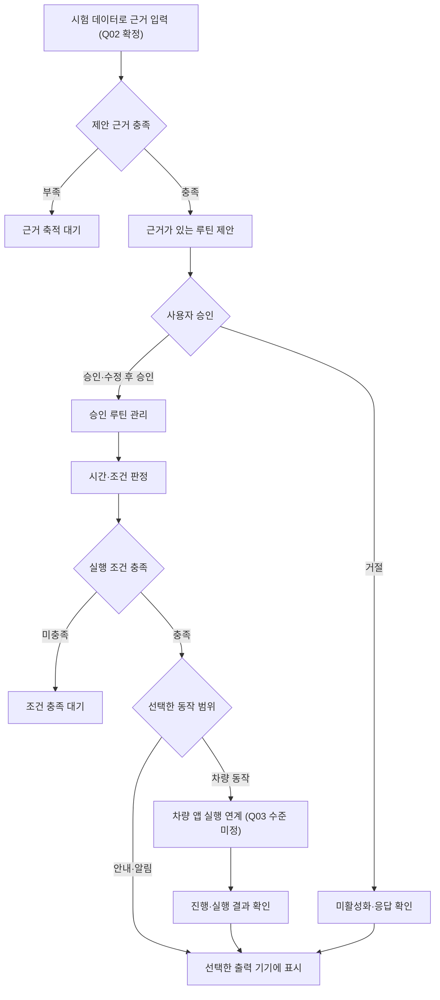

# 루플레 1차 프로토타입 범위와 완료 기준

합의한 제품 기획을 바탕으로 1차 프로토타입의 구현 범위와 완료 판정을 정리합니다. 네 가지 입출력 경로 모두 검증, 시험 데이터 기반 자동 제안 흐름 검증, 핵심 기능 모두 포함을 확정했습니다. 실제 입력 데이터 연동은 별도 검증으로 분리합니다. 차량 연동·시연 수준과 세부 완료 기준은 아래의 질문과 검토안으로 관리합니다.

- 기준일: 2026년 10월 26일
- 문서 상태: 2026년 10월 26일 제품·아키텍처·개발 진행 기준 확정 반영. 세부 완료 기준은 상세화 대상
- 범위 확정 상태: 핵심 기능·네 경로·시험 입력·차량 에뮬레이터·11월 15일 제출·개인 서버/DGX Spark 자원 확정. 우선 모바일 OS·구체 차량 연동 수준·세부 기술 환경 미정
- 세부 완료 기준·증빙: 검토안, 사용자 확인 전
- 실제 구현·검증 상태: 제품 통합 프로토타입의 완료 판정 항목 없음. 개별 Pleos 검증 앱의 결과는 연구 문서에서 별도 관리
- 근거: 현재 기획 대화, [입출력과 역할 아키텍처](../architecture/README.md), [기능 모듈과 연결 계약](../architecture/functional-modules.md)

제품 방향·모듈 책임·개발 계획의 확정과 실제 구현·검증 완료는 구분합니다. [전체 아키텍처와 제출 개발 계획](full-architecture-review-2026-10-26.md)에 확정한 작업 묶음·진행 기준과 상태형 관리·SLM·음성·동적 화면의 조건부 확장 목표를 정리했습니다. 연결 계약의 전송·저장 형식은 후속 상세화 대상입니다.

## 합의한 제품 방향

| 기준 | 합의 내용 | 1차 범위에 적용할 때 확인할 사항 |
| --- | --- | --- |
| 핵심 가치 | 출퇴근뿐 아니라 몇 달 간격의 방문도 기억하고 준비 | 제시한 장주기 사례의 시험 입력·기대 결과·재현 방식 |
| 기본 이용 방식 | 집·회사·내비 등록 장소를 먼저 근거로 제안. 등록 장소가 없으면 이동 근거 축적 후 제안, 근거가 전혀 없으면 수동 등록 선택 제공 | [초기 제안 정책](../requirements/initial-routine-proposal.md)의 유효성·주기 확인·추가 근거 판정 상세 명세 |
| 제안·승인 | 추정한 후보는 사용자 승인·수정 후 루틴으로 활성화 | 검증할 승인·수정·거절 시나리오 |
| 역할 | 차량 앱이 메인, 스마트폰은 관리·가시화 컴패니언, 서버는 Automation Hub | 시연 환경과 실제 연결 수준 |
| 입출력 | 차량·스마트폰 어디서든 입력하고 어느 기기로든 결과 표시 | 네 경로 모두 1차 검증 대상으로 확정 |
| 실행 책임 | 차량 동작이 포함되면 차량 앱이 실행하고 진행·결과를 서버에 보고 | 실제 차량 연동과 대체 응답 중 선택 |
| 데이터 구분 | 목적지 지정·실제 방문·패턴 추정·사용자 승인을 구분 | 실제 입력 확보 범위와 기능별 판정 기준 |
| 엔진 구분 | 패턴 엔진은 후보 생성, 규칙 엔진은 승인 루틴의 조건 판정 | 상세 판정 로직과 구현 방식 |
| 확장 제품 방향 | 이동·차량 관리 루틴 통합, 개인화 알림, 팀 서버 SLM, 음성·카드 중심 동적 화면·보조 채팅 | 제출에서는 대표 흐름의 조건부 확장 목표. 모든 외부 API·새 SDK의 실제 연동을 필수로 확대하지 않음 |

이 표는 제품 기획의 기준입니다. 1차 핵심 범위는 아래에 반영했으며 세부 구현·완료 조건은 별도로 구체화합니다.

차량 측 1차 검증은 Pleos 에뮬레이터로 수행하며 실차 검증을 필수로 요구하지 않습니다. 제출 마감은 2026년 11월 15일이고 개인 서버·DGX Spark를 사용합니다. Android·iPhone 시험 기기는 확보 가능하며 우선 구현 OS는 미정입니다. 구체 실행 기능·SDK 연동/대체 응답 수준·서버 접속·런타임은 별도 결정·검증 사항입니다.

## 1차 검증 목표

자동 제안, 승인·수동 등록, 조회·수정·삭제, 장주기 알림, 실행 진행·결과 표시를 1차 필수 범위로 포함합니다(Q05). 근거 입력에서 이 기능들이 연결되는 흐름을 검증하며, 상세 판정과 증빙은 후속 명세에서 정합니다. 차량 기능이 포함되는 경우에는 Q03에서 선택한 연동 수준에 맞춰 차량 앱의 실행 경계를 검증합니다.

장주기 알림을 검증해 몇 달 간격의 방문을 챙긴다는 가치를 확인합니다. 구체적인 장소·주기·알림 시점과 장주기 재현 방식은 아직 정하지 않았습니다.

조회·수정·삭제와 수동 등록은 1차 루틴 관리 범위에 포함합니다. 입력 기기와 결과 표시 기기를 분리하며, 네 가지 경로를 모두 검증합니다. 각 경로에 적용할 세부 조작·예외의 검증 범위는 아래 완료 기준안을 검토하면서 정합니다.

## 1차 범위와 상세화 항목

| 항목 | 1차에 검토할 내용 | 범위 상태 |
| --- | --- | --- |
| 네 입출력 경로 | 스마트폰 입력·스마트폰 표시, 스마트폰 입력·차량 표시, 차량 입력·스마트폰 표시, 차량 입력·차량 표시 | 사용자 확정: Q01 |
| 자동 제안 | 근거와 주기·조건의 추정·미확인 상태를 구분하는 후보 제안 | 1차 필수 기능: Q05 확정, 상세 명세는 미정 |
| 승인·등록 | 승인·수정 후 승인·거절, 보조 기능인 수동 등록 | 승인·수동 등록 포함: Q05 확정, 세부 시나리오는 미정 |
| 루틴 관리 | 등록·조회·수정·삭제와 다른 기기에서의 결과 확인 | 1차 필수 기능: Q05 확정, 경로별 검증 깊이는 미정 |
| 장주기 알림 | 몇 달 간격의 방문에 대한 준비 시점과 알림 재현 | 1차 필수 기능: Q05 확정, 기존 사례의 시험 입력·기대 결과·재현 방식은 미정 |
| 조건 판정 | 승인된 활성 루틴의 시간·조건에 따른 실행 준비 | 핵심 기능을 뒷받침하는 설계 검토 항목, 상세 로직 미정 |
| 진행·결과 가시화 | 요청 처리, 기기 전달, 차량 동작의 진행·결과 구분 | 1차 필수 기능: Q05 확정, 표시 상태·증빙은 미정 |
| 입력 데이터 확보 | 시험 데이터로 자동 제안 흐름 검증, 실제 데이터 연동은 별도 검증 | 사용자 확정: Q02 |
| 차량 실행 연계 | 대체 응답으로 흐름 검증 또는 실제 차량 기능 연동 | Q03 답변 대기 |
| 실행·시연 환경 | 차량은 Pleos 에뮬레이터, 개인 서버와 DGX Spark, Android·iPhone 시험 기기 사용 가능 | 자원 확정. 우선 모바일 OS·실제 설치·접속·런타임은 미정/미검증 |
| 제출 목표일 | 2026년 11월 15일 접수 마감, 11월 13일 제출 후보 확보를 진행 기준으로 관리 | Q04 제출일과 전체 진행 기준 확정. 완료 보장과 구분 |
| 확장 대표 흐름 | 상태형 입력·서버 SLM·카드·제한된 음성을 기존 통합 흐름에 추가 | 조건부 목표 확정. 상세 사례·검증 깊이는 후속 결정 |

이 목록은 확정된 1차 기능 범위와 후속 결정 사항을 구분합니다. 기능 포함의 확정을 세부 명세·성능 수치·일정의 확정으로 확대하지 않습니다. 미정 항목은 후속 설계와 계획에서 확인합니다.

## 네 가지 경로의 검증 대상

| 사례 | 입력 기기 | 결과 표시 기기 | 1차 경로 포함 | 세부 검증 내용 |
| --- | --- | --- | --- | --- |
| SC01 | 스마트폰 앱 | 스마트폰 앱 | 확정 | 선택한 제안·관리·실행 시나리오의 처리 결과 확인 |
| SC02 | 스마트폰 앱 | 차량 앱 | 확정 | 스마트폰 입력 결과와 차량 전달·표시 상태를 구분해 확인 |
| SC03 | 차량 앱 | 스마트폰 앱 | 확정 | 차량 입력 결과와 스마트폰 전달·표시 상태를 구분해 확인 |
| SC04 | 차량 앱 | 차량 앱 | 확정 | 차량에서 입력·표시하는 경우에도 서버 상태와 차량 동작 결과를 구분해 확인 |

차량 동작을 포함하는 사례는 Q03의 선택 수준을 적용합니다. 결과 표시 대상이 스마트폰이어도 차량 동작의 실행 주체는 차량 앱입니다.

조회·수정·삭제 등 모든 조작을 모든 경로에서 교차 검증할지, 경로별 대표 조작을 선정할지는 완료 기준 검토 때 확인합니다. 네 경로 포함 결정을 전체 기능·예외의 모든 조합 검증으로 확대 해석하지 않습니다.

## 완료 기준안

AC01의 경로 포함, AC02의 시험 데이터 적용, Q05의 핵심 기능 포함은 사용자 확정 사항입니다. 아래의 상세 판정 방법·예외·증빙은 검토안입니다. 기능별 명세에서 해당 조건을 확정한 후 완료 판정에 사용합니다. 현재 모든 항목의 실제 검증 상태는 미검증입니다.

| 기준 | 관찰 가능한 판정 조건안 | 필요한 증빙안 | 적용·확인 상태 |
| --- | --- | --- | --- |
| AC01 경로 검증 | SC01~SC04에서 입력·서버 처리·대상 기기의 결과 표시가 연결되고, 입력 요청 처리와 대상 전달의 결과를 구분 | 사례별 입력·처리·출력 결과와 실행 환경 기록 | 네 경로 포함 확정, 세부 판정·증빙 확인 대기 |
| AC02 입력 근거 | 시험 데이터임을 표시하고 그 근거가 자동 제안 흐름에 사용됨. 실제 데이터 연동은 별도 검증으로 구분 | 시험 자료·입력 결과·별도 연동 검증 항목 | 시험 데이터 적용 확정, 자료 구성·세부 판정 확인 대기 |
| AC03 자동 제안 | 근거와 조건의 추정·미확인 상태를 구분하고, 미등록 장소의 1회 이력만으로 즉시 반복 루틴을 제안하지 않음 | 근거가 있는 입력과 부족한 입력의 결과 비교 | 기능 포함 확정, 세부 제안 기준·증빙 확인 대기 |
| AC04 사용자 승인·수동 등록 | 승인 전·거절 시 활성화되지 않고, 승인·수정 후 승인한 내용이 루틴 정의에 반영됨. 수동 등록은 패턴 분석을 기다리지 않고 사용자 확인을 거쳐 등록 | 승인 전후·거절·수정 후 승인·수동 등록 결과 | 기능 포함 확정, 세부 시나리오·증빙 확인 대기 |
| AC05 관리 결과 | 등록·조회·수정·삭제 조작이 서버 기준 상태와 대상 앱에 반영됨. 삭제된 루틴을 신규 실행 대상으로 삼지 않음 | 변경 전후 상태와 기기별 반영 결과 | 기능 포함 확정, 경로별 조작·예외 검증 범위 확인 대기 |
| AC06 장주기 알림 | 선택한 장주기 사례에서 정한 조건 전후로 준비 상태·알림을 구분해 확인 | 입력 이력·시각·승인 조건·예상 결과와 실제 결과 | 기능 포함 확정, 사례·재현 방식·조건 확인 대기 |
| AC07 상태 가시화 | 루틴 저장, 기기 전달 대기, 실제 실행 진행·결과를 혼동하지 않고 표시 | 상태별 화면 또는 처리 기록 | 기능 포함 확정, 표시할 상태·증빙 확인 대기 |
| AC08 차량 실행 | 선택한 수준에 맞춰 차량 작업 요청과 진행·결과를 연결. 대체 응답이면 대체 응답임을 표시하고, 실제 연동이면 선택 기능의 성공 판정 기준으로 확인 | 요청·보고·표시 결과, 실제·대체 연동의 구분 | Q03과 구체 기능 결정 후 확정 |
| AC09 방문 확인 | 안내 전달·내비 요청·차량 작업 완료만으로 실제 장소 방문 완료를 확정하지 않음 | 실행 결과와 방문 확인의 구분 | 관련 기능 범위·검증 방법 확인 대기 |

시험 자료나 시험 시각으로 장주기를 재현하는 방식을 채택하면 그 사실을 시연과 검증 기록에 표시합니다. 이를 실제 수개월 운영·학습 성과로 판정하지 않습니다. 추천 정확도, 사용자 유지율, 월간 활성 사용자 수 등 합의하지 않은 수치를 완료 기준으로 만들지 않습니다.

저장·전달·실행·방문 확인에 관한 판정은 구분합니다. 구체적인 데이터 형식·화면·지연 시간·재시도·동시 변경 정책은 후속 명세에서 정합니다.

## 검증 증빙과 완료 판정

증빙 묶음은 입력 자료·환경, 실행 절차, 기대 결과, 실제 결과와 실패·미확인 항목을 연결하는 안을 제안합니다. 설치 파일·시연 영상 등 최종 제출 형태는 아직 정하지 않았습니다.

완료 판정은 다음 사항을 정한 뒤 수행합니다.

1. 기능 범위와 필수 완료 기준 확정
2. 선택한 입력 데이터·차량 연동 수준과 시연 환경 명시
3. 네 경로의 선택된 검증 사례 수행
4. 기대 결과와 실제 결과 대조 및 미해결 사항 확인
5. 진민의 완료 확인

문서 작성, 커밋, 화면 제작만으로 프로토타입이 완료됐다고 판정하지 않습니다. 미검증·미지원·대체 응답을 성공한 실제 연동으로 표시하지 않습니다.

## 현재 결정 사항과 질문

| 질문 | 결정할 내용 | 상태 | 답변·처리 |
| --- | --- | --- | --- |
| Q01 | 1차에서 네 입출력 경로를 모두 검증할지 | 사용자 확정 | 네 가지 경로 모두 검증 |
| Q02 | 자동 제안 입력 데이터의 1차 적용 수준 | 사용자 확정 | 시험 데이터로 흐름 검증, 실제 연동은 별도 검증 |
| Q03 | 차량 실행은 대체 응답으로 요청·진행·결과를 검증할지, 최소 한 가지 실제 차량 기능 연동을 포함할지 | 질문 전달, 답변 대기 | 미정 |
| Q04 | 1차 제출일과 차량·스마트폰·서버의 시연 환경 | 사용자 확정·세부 환경 미정 | 11월 15일 제출, 차량 에뮬레이터 충분, 개인 서버·DGX Spark·Android/iPhone 사용 가능. 우선 모바일 OS·접속·런타임 미정/미검증 |
| Q05 | 자동 제안, 승인·수동 등록, 조회·수정·삭제, 장주기 알림, 실행 진행·결과 표시의 1차 필수 포함 여부 | 사용자 확정 | 핵심 기능 모두 포함. 기능별 예외·경로별 검증 깊이는 이후 명세에서 별도로 결정 |
| Q06 | 기존 장주기 사례의 시연 대상·입력 주기·조건·기대 결과·재현 방식 | 상세 시연 시나리오에서 확인 | 미정 |
| Q07 | 실행 가능한 결과물·시연 영상·검증 기록 등 완료 증빙의 제출 형태 | 계획 구체화 때 확인 | 미정 |
| Q08 | 각 경로에서 교차 검증할 조작·예외의 범위 | 기능별 명세와 검증 계획에서 확인 | 미정 |
| Q09 | 상태형 관리·SLM·음성·동적 화면의 제출 적용 | 조건부 목표 사용자 확정 | 기존 필수 통합 우선, 대표 흐름 확장을 날짜별 진행 기준에 따라 관리. 모든 API 실연동·자유 대화·양쪽 OS 동시 완성은 필수로 두지 않음 |

Q04의 제출일과 보유 자원을 반영했고, Q03의 제품 차량 연동 수준과 우선 모바일 OS·접속·런타임은 추가 결정·검증 대상으로 둡니다. Q05의 핵심 기능과 Q02의 시험 입력 기준을 유지하며, Q09는 조건부 확장으로 관리합니다. 기존 사례의 시험 입력·기대 결과·증빙·검증 깊이는 Q06~Q08과 연결해 상세화합니다. 미정 선택지나 예시를 확정값으로 사용하지 않습니다.

## 후속 상세 설계와 장기 비전

[필요 데이터와 Pleos API 대응표](../research/pleos-data-api-matrix.md)에서 공개 문서로 확인한 API와 실제 호출·환경 검증이 필요한 항목을 구분합니다. 개발·검증 단계 제안은 이 문서의 Q03·Q04 결정을 대신하지 않습니다.

로그인·기기 연결, 출력 대상 결정, 데이터 이용 범위, 제안 기준, 차량 기능·권한, 내부 알고리즘·기술 스택과 배포 구성은 후속 상세 설계 사항입니다. 필요한 확인 작업도 이후 작업 계획에 포함합니다.

개인화 이동 맥락 데이터의 축적과 제조사 협력에 따른 에너지 관리·자율주행 개인화 연계, 동의 기반 집단 추천·장소 대체 추천·광고는 기존 기획의 장기 확장으로 유지합니다. 해당 비전을 현재 프로토타입의 구현 완료나 차량 제어 권한 확보로 간주하지 않습니다.

다음 단계는 확정한 M1~M6와 A·B·C 작업 묶음·추진 항목·날짜별 진행 기준을 바탕으로 기능 요구사항·세부 계약·개별 공수를 구체화하는 것입니다. 담당 실명과 모바일 OS·기존 사례의 시험 입력·기대 결과·차량 연동 수준을 추가 결정합니다. 실제 SDK·외부 연동 검증과 공통 계약·작은 통합 흐름을 병행합니다.
