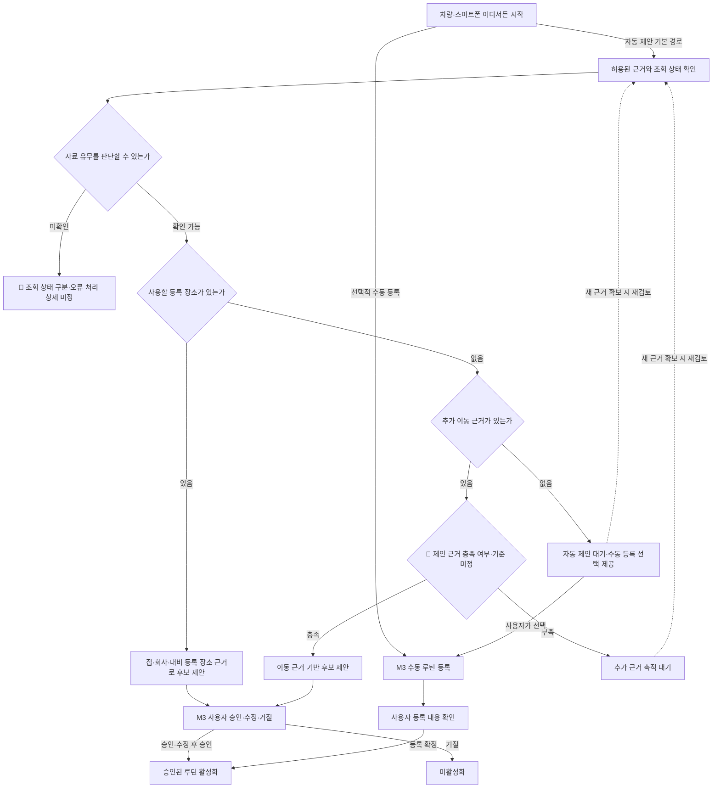

# 초기 루틴 제안 정책과 요구사항 초안

집·회사와 내비 등록 장소를 먼저 루틴 제안의 근거로 사용합니다. 등록 장소가 없으면 추가 이동 근거를 축적한 뒤 제안하고, 사용할 근거가 전혀 없으면 자동 제안을 기다리면서 수동 루틴 등록을 선택할 수 있도록 합니다.

- 분류·목적: 프로젝트. 첫 실행의 근거 상태에 따른 분기를 정해 M1 수집·M2 제안·M3 승인 명세의 기준으로 사용
- 기준일: 2026년 10월 26일
- 이어짐: [1차 범위](../planning/prototype-v1-scope.md), [기능 모듈과 계약](../architecture/functional-modules.md), [SDK 실행 결과](../research/pleos-nav-probe-results.md)
- 사용자 결정 근거: 이번 대화에서 집·회사와 내비 등록 장소 우선 제안, 해당 정보 부재 시 이동 근거 축적 후 제안, 완전한 데이터 부재 시 수동 등록 제공을 명시
- 확인 구분: 위 초기 정책은 진민 결정. 아래 요구사항 배치·도해·검증안의 세부 표현은 AI 작성 초안이며 진민 확인 전
- 영향 범위: 초기 후보 선정·근거 대기·수동 등록 진입. 기존 승인 전 미활성화, 네 입출력 경로, 장주기 알림 범위는 유지
- 이번에 변경하지 않는 항목: 구현 코드, 제안 횟수·기간 기준, 방문 판단 알고리즘, 화면 설계, 기술 스택, 담당자·일정

## 근거 상태별 동작

| 근거 상태 | 기본 동작 | 판정 경계 |
| --- | --- | --- |
| 내용이 채워진 집·회사 또는 내비 등록 장소가 있음 | 등록 장소를 근거로 루틴 후보를 먼저 제안 | 등록은 장소 후보의 근거. 반복 방문·주기·방문 완료를 자동 확정하지 않음 |
| 사용할 등록 장소가 없지만 추가 이동 근거가 있음 | 축적한 근거가 제안 조건을 충족하면 제안, 부족하면 관찰 대기 | 🚧 이동 근거의 종류와 충족 기준은 후속 명세에서 결정 |
| 등록 장소와 이동 근거가 모두 없음 | 자동 제안 대기와 선택적 수동 루틴 등록 제공 | 수동 등록을 필수 온보딩으로 만들지 않음. 이후 근거가 확보되면 자동 제안 검토 가능 |
| 조회 실패·콜백 미수신 등으로 자료 유무를 모름 | 미확인 상태를 구분 | 빈 목록이나 자료 부재로 확정하지 않음. 🚧 오류 표시·재조회 방식은 미정 |

집·회사와 일반 등록 장소는 등록 근거를 우선 활용하는 범위에 함께 포함합니다. 두 종류의 표시 순위·노출량을 이번 결정으로 정하지 않습니다. 수동 등록은 기존 M3의 선택 기능으로 유지하며, 근거가 전혀 없는 경우에도 사용할 수 있습니다.

등록 근거 우선은 첫 진입의 출발점입니다. 이후 이동 근거를 축적해 새로운 루틴을 제안하는 기존 제품 방향은 유지하며, 등록 장소가 있다는 이유로 학습을 중단하는 정책을 뜻하지 않습니다.

## 초기 분기

아래는 자료 조회 상태와 확보한 근거에 따른 제품 동작을 표현한 초안입니다. 로그인·동의·기기 연결·SDK 초기화의 구체적인 순서는 후속 상세 설계 사항입니다.

도해의 빈 근거 상태는 자동 관찰 대기와 수동 등록 선택이 함께 가능한 상태입니다. 수동 등록을 마칠 때까지 자동 제안을 막는 순서를 뜻하지 않습니다. 다른 상태에서도 수동 등록은 기존 선택 기능으로 제공하며, 재검토 시점·동기화 정책은 아직 정하지 않습니다.

## 모듈 요구사항 연결안

아래 책임 배치는 기존 논리 모듈안을 따릅니다. 저장 형식·전송 계약·물리 배포를 확정하는 내용은 아닙니다.

| 요구사항 | 연결 모듈 | 요구 내용 |
| --- | --- | --- |
| INIT01 등록 근거 확인 | M1 | 집·회사·일반 등록 장소를 구분하되, 분류만 있는 항목과 내용이 있는 장소를 구분 |
| INIT02 근거 상태 구분 | M1 | 자료 있음·확인된 자료 없음·조회 미확인을 구분하고 출처와 관찰 시각을 유지 |
| INIT03 등록 장소 우선 제안 | M2 | 사용할 등록 장소가 있으면 해당 근거를 활용한 후보 제안을 기본 경로로 구성 |
| INIT04 근거 축적 후 제안 | M1·M2 | 등록 장소가 없으면 이동 근거를 축적하고 충족 여부를 검토. 미등록 장소 1회의 이력만으로 즉시 반복 루틴을 제안하지 않음 |
| INIT05 수동 등록 선택 | M3 | 근거가 없어도 사용자가 수동 루틴 등록을 선택할 수 있게 하고 패턴 분석 완료를 요구하지 않음 |
| INIT06 승인 경계 | M2·M3 | 등록 장소와 추정 후보를 승인된 루틴으로 구분. 승인·수정 후 승인 전에는 자동 활성화하지 않음 |
| INIT07 양쪽 진입·표시 | 기능 화면·M6 | 어느 기기에서 시작하든 같은 정책을 적용하며, 표시 기기와 입력 기기를 구분하는 기존 기준 유지 |

## SDK 결과를 적용할 때의 제약

실행 검증에서는 HOME·OFFICE 분류가 있어도 이름·주소·식별자가 비어 있고 좌표가 모두 0인 초기 항목이 반환됐습니다. 분류 항목이 존재한다는 이유만으로 등록 장소가 있다고 처리하면 안 됩니다. 🚧 구체적인 유효성 판정 기준은 아직 정하지 않았으며, 일부 필드가 빠졌다는 이유로 모든 장소를 일괄 제외하는 규칙도 만들지 않습니다.

현재 조회 모델에는 방문일·횟수·주기가 없습니다. 등록 정보만으로 주기를 채우거나 자료 수신 시각을 방문 시각으로 사용하지 않습니다. 🚧 등록 기반 후보에서 주기·시간·조건을 어떻게 표시·질문·확정할지는 M2·M3 명세에서 진민과 정합니다.

최근 목적지와 실제 방문은 구분합니다. 동일 목록을 다시 읽은 횟수도 반복 방문 횟수로 환산하지 않습니다. 🚧 추가 이동 근거의 수집 종류·식별·중복 처리·방문 판단은 후속 상세 설계 사항입니다.

## 검증 사례안

이 절은 정책에서 도출한 검증 초안입니다. 아래 사례의 제품 동작은 아직 구현·실행하지 않았습니다. 시험 자료 사용 여부를 구분하고 실제 수개월 학습으로 표시하지 않습니다.

| 사례 | 기대하는 제품 동작 | 세부 미정 항목 |
| --- | --- | --- |
| 내용이 있는 집·회사·일반 등록 장소 제공 | 등록 근거 기반 후보를 제안하고 사용자 승인 전 미활성화 | 🚧 주기 없는 후보의 제안 내용·확인 항목 |
| HOME·OFFICE 분류만 있고 장소 내용은 비어 있음 | 분류만으로 등록된 장소라고 판정하지 않음 | 🚧 유효성 기준 |
| 등록 장소 없음, 이동 근거 부족 | 근거를 기다리며 즉시 반복 루틴을 제안하지 않음 | 🚧 부족·충족 판정 기준 |
| 등록 장소 없음, 합의한 조건을 충족하는 시험 이동 근거 제공 | 해당 근거를 설명하는 후보 제안 | 🚧 근거 종류·판정 조건·대표 사례 |
| 등록 장소·이동 근거 모두 없음 | 자동 제안 대기와 수동 등록 선택 제공. 수동 등록 강제 없음 | 🚧 빈 상태 화면·안내 문구 |
| 조회 실패·콜백 미수신 | 자료 없음으로 오판하지 않음 | 🚧 오류·재조회·수동 등록 화면 연결 |

## 다음 명세에서 확인할 질문

- 🚧 등록 장소를 사용할 수 있다고 판단하는 최소 조건은 무엇인가?
- 🚧 주기 정보가 없는 등록 장소의 제안에는 어떤 내용과 확인 항목을 보여줄 것인가?
- 🚧 추가 이동 근거는 어떤 관찰로 확보하며, 어느 조건에서 제안을 시작할 것인가?
- 🚧 후보·승인 루틴·장소의 중복과 거절 후 재제안을 어떻게 처리할 것인가?

이 질문의 답을 정한 뒤 M1 입력·출력과 M2·M3의 제안·승인 계약을 구체화합니다. 수치·일정·담당자·기술 스택은 이 문서에서 임의로 채우지 않습니다.
