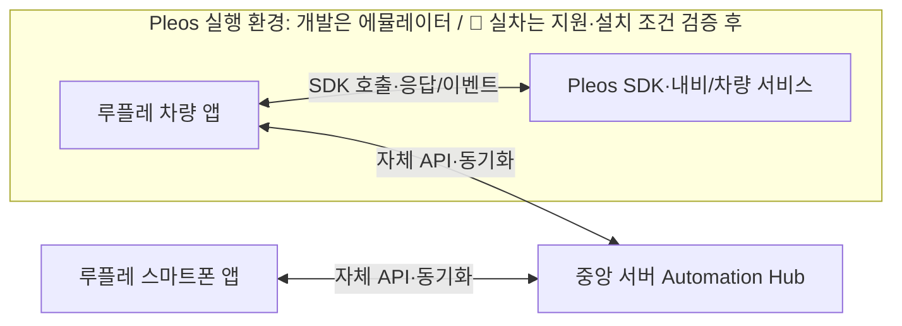
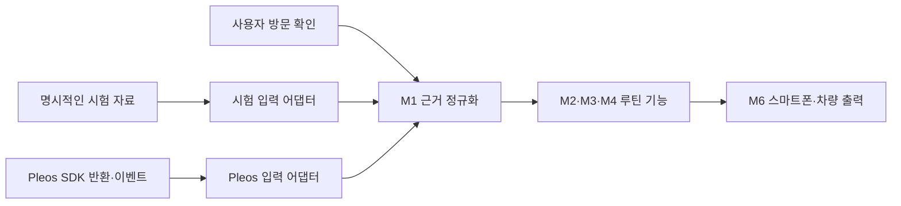
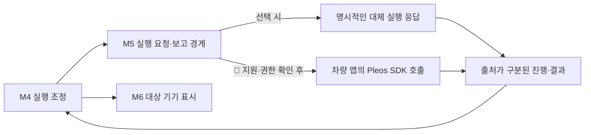

# 루플레 필요 데이터와 Pleos API 대응표

루틴 제안·관리·실행에 필요한 정보와 대응하는 Pleos API를 정리합니다. 공개 문서에서 항목을 확인한 수준과 실제 SDK 호출·반환 자료·차량 동작을 검증한 수준을 구분합니다.

- 확인일: 2026년 10월 26일
- 상태: 공개 문서 조사와 선택 조회·내비 실행 API의 에뮬레이터 검증
- 실제 SDK 호출: [즐겨찾기·최근 목적지 조회](pleos-nav-probe-results.md), [내비 요청·취소·전경 화면 및 목적지·경로 상태·현재 위치 조회](pleos-navigation-execution.md) 확인. 그 외 API·실차는 미검증
- 개발 프로젝트별 SDK 승인 상태: 🚧 미검증. 공개 배포 파일 접근과 가상 기기의 조회 권한은 실행 결과에서 구분
- 기획 기준: [입출력과 역할](../architecture/README.md), [기능 모듈](../architecture/functional-modules.md), [1차 프로토타입 범위](../planning/prototype-v1-scope.md)

1차 자동 제안 흐름은 시험 데이터로 검증하고 실제 데이터 연동은 별도 검증하기로 한 결정을 유지합니다. 이 조사가 차량 실행의 1차 연동 수준이나 시연 환경을 확정하지는 않습니다.

## 확인 수준

| 구분 | 의미 | 이번 조사 상태 |
| --- | --- | --- |
| 문서 항목 확인 | 공식 참조에 API·이벤트·설명이 존재 | 아래 대응표에 근거 연결 |
| 접근·버전 확인 | 해당 프로젝트에서 쓸 수 있는 SDK·권한·버전 확인 | 공개 NaviHelper 3.0.5 배포·빌드와 가상 기기의 NAVI_ROUTE·NAVI_ROUTE_SEARCH·NAVI_CUSTOM_MAP 권한 확인. 계정별 프로젝트 승인 상태는 미검증 |
| 호출·반환 확인 | 실행 환경에서 호출하고 실제 응답·이벤트·필드 확인 | 두 목록 조회와 선택한 내비 실행·맥락 조회를 에뮬레이터에서 확인. 구형 완료 콜백 수신 등 제약은 개별 결과에 기록 |
| 차량 동작 확인 | 지원 차량에서 실제 상태 변화·실행 결과 확인 | 미검증 |

문서에 있다는 사실을 데이터 수신 성공이나 실차 지원으로 표시하지 않습니다. 조회가 성공해도 빈 목록·값 없음이 반환될 수 있으며, 이벤트 미수신은 빈 목록 반환과 구분해 확인해야 합니다.

## 입력 데이터 대응표

필요 데이터는 제품 기획에 대응한 조사 항목입니다. 선택 맥락·확장 항목을 모두 1차 필수 기능으로 추가하는 것은 아닙니다.

| 데이터·용도 | 대응 API·이벤트 | 문서에서 확인한 범위 | 실제 관찰과 🚧 남은 확인 사항 | 근거 |
| --- | --- | --- | --- | --- |
| 등록 장소·즐겨찾기: 초기 장소 후보의 근거 | `getBookmarkInfo()`, `onBookmarkInfo()`, `onBookMarkChanged()` | 조회 메서드와 관련 이벤트 항목 존재 | 에뮬레이터에서 HOME·OFFICE·DEFAULT와 장소명·좌표·주소·식별자 수신 확인. 초기 HOME·OFFICE의 장소 내용은 비어 있었음. 🚧 프로필 범위·변경 이벤트·집/회사 실제 등록은 미검증. [실행 결과](pleos-nav-probe-results.md) | [S01] [S02] |
| 최근 목적지: 반복·관심 장소 후보의 근거 | `getRecentDestinationInfo()`, `onRecentDestinationInfo()` | 조회 메서드와 관련 이벤트 항목 존재 | 에뮬레이터에서 빈 목록과 목적지 지정 후 1개 항목 수신. 현재 모델에 방문 시각·횟수 없음. 🚧 조회 범위·정렬·중복·보존 기간·프로필 범위는 미검증. [실행 결과](pleos-nav-probe-results.md) | [S01] [S02] |
| 현재 목적지·경유지: 현재 이동 맥락 | `getDestinationInfo()`, `getWaypointInfo()`, `onDestinationInfo()`, `onWayPointInfo()` | 정보 조회 메서드·이벤트 존재. 목적지 가이드는 조회 결과를 콜백에서 처리하도록 안내 | 현재 목적지의 이름·식별자·좌표·잔여 정보 수신과 취소 뒤 빈 목적지 확인. 🚧 경유지·프로필 범위·요청 좌표와 반환 좌표 차이의 원인은 미검증. [내비 실행 결과](pleos-navigation-execution.md) | [S01] [S02] [S03] |
| 경로 상태·안내 진행: 루틴 진행 맥락 | `getRouteStateInfo()`, `onRouteStateInfo()`, `onNavigationStatus()`, `onDrivingInfo()` | 조회·상태 이벤트 항목 존재. 이벤트 전달은 내비 앱 구현 시나리오에 따라 달라질 수 있음 | ROUTE_GUIDING·SAFE_GUIDING과 ROUTE_DRIVE·FREE_DRIVE 관찰. 구형 탐색 완료 콜백 onRouteEnded 수신, onRoutingCompleted 미수신. 🚧 onDrivingInfo·재연결·제품 실행 상태 대응은 미검증. [내비 실행 결과](pleos-navigation-execution.md) | [S01] [S02] |
| 목적지 도착 신호: 방문 판단에 사용할 수 있는 관찰 후보 | `onDestinationArrived()`, `onWayPointArrived()` | 도착 관련 이벤트 항목 존재 | 발생 조건·중복·오차, 목적지 식별, 타임스탬프 제공 여부. 내비 도착을 실제 장소 방문·서비스 이용 완료로 간주하지 않음 | [S02] |
| 현재 위치: 접근·이동 조건의 선택 맥락 | NaviHelper `getCurrentLocationInfo()`·`onCurrentLocationInfo()` 또는 FusedLocation `getLastKnownLocation()`·위치 업데이트 | NaviHelper 조회·이벤트 존재. FusedLocation 소개는 위치·시각 정보와 지원 여부 확인, 값 없음 가능성을 설명 | NaviHelper에서 좌표·방향·주소·경로 식별자·인덱스 수신 확인. 🚧 정확도·갱신·실차·FusedLocation은 미검증. 관찰 시각을 과거 방문 시각으로 쓰지 않음. [내비 실행 결과](pleos-navigation-execution.md) | [S01] [S02] [S05] [S08] |
| 남은 거리·시간과 교통 맥락: 이동 준비 보완의 선택 항목 | `getDestinationInfo()`, `getRouteStateInfo()` 등 | 릴리즈 노트에 `DestinationInfo`의 `remainDistance`·`remainTime` 필드 변경이 안내됨 | 잔여 거리·시간 필드와 경로 교통 상태 객체 수신. 🚧 단위·갱신·신선도는 상세 검증 필요. 외부 전체 교통정보 제공을 보장하지 않음. [내비 실행 결과](pleos-navigation-execution.md) | [S02] [S03] [S10] |
| 차량 상태: 정차·차량 상태 등 조건의 선택 맥락 | Vehicle SDK의 해당 상태 조회·구독 API, 구체 메서드는 미선정 | 접근 안내는 Vehicle State를 별도 접근 항목으로 구분 | 필요한 상태를 먼저 선정하고 대응 API·지원 영역·권한·반환값 검증. 앱 연결 상태와 차량 전원·운행 상태를 동일시하지 않음 | [S05] |
| 과거 실제 방문일·횟수·주기: 장주기 추정의 핵심 근거 | 이를 일괄 보장하는 단일 API는 이번 조사에서 확인하지 못함. 최근 목적지·도착 이벤트·사용자 확인을 구분해 검토 | 최근 목적지·도착 관련 API 항목의 존재까지 확인 | 현재 두 조회 모델·응답으로 과거 방문 시각·횟수를 확보하지 못함. 🚧 도착 관찰과 M1의 근거 축적·사용자 확인 정책은 후속 설계 | [S01] [S02] |
| 마이현대 등의 정비 예약: 향후 예약 근거 후보 | 이번 조사에서 대응 Pleos API 미확인 | 검토한 NaviHelper·접근 안내만으로 제공 여부를 확인할 수 없음 | 별도 서비스 연계·제공 조건·사용자 동의가 필요한지 확인. 다른 앱의 예약 자료를 읽을 수 있다고 가정하지 않음 | [S01] [S05] 및 추가 조사 필요 |

최근 목적지 목록을 수신한 시각은 그 장소에 방문한 시각이 아닙니다. 등록 장소도 반복 방문 횟수나 주기를 증명하지 않습니다. 필요한 필드가 없으면 수집 시각이나 추정값으로 과거 방문 사실을 채우지 않습니다.

## 실행·출력과 자체 데이터

| 필요 정보·동작 | 대응 경계 | 문서·기획에서 확인한 내용 | 실제 검증·후속 결정 |
| --- | --- | --- | --- |
| 내비 목적지·경로 요청과 결과 | `requestRoute()`, `getDestinationInfo()`, `cancelRoute()`, 경로·오류 콜백 | 공식 가이드는 요청 성공과 경로 탐색 완료를 구분하도록 안내 | 에뮬레이터에서 SDK 경로 요청·구형 완료 콜백·목적지 이름/식별자 반영·취소 확인. 🚧 신규 완료 콜백·좌표 차이·오류 분기는 미검증. 루틴 삭제와 자동 취소 정책은 미정. [내비 실행 결과](pleos-navigation-execution.md), [S02] [S03] |
| 내비 화면 요청 | `requestNavigationScreen()` | 공식 API 참조와 권한 안내에 항목 존재 | Foreground 요청 전후 전경 Activity와 실제 안내 화면을 에뮬레이터에서 확인. 🚧 다른 화면 요청·실차·실패 상황은 미검증. 1차 필수 기능 수준은 Q03과 별도. [내비 실행 결과](pleos-navigation-execution.md), [S01] [S04] |
| 다른 차량 기능 실행 | M5의 Vehicle SDK 실행 어댑터, 구체 동작·메서드 미정 | SDK 접근 안내에서 Vehicle Control을 별도 상태로 안내 | 프로젝트 접근 상태, 구체 기능·지원·권한·실제 상태 변화 검증 후 판단. 가상 콘솔의 조작 가능성을 우리 앱의 제어 권한으로 해석하지 않음. [S05] [S07] |
| 사용자 승인·수동 등록·루틴 정의·수정·삭제 | 루플레 M2·M3의 앱·서버 상태 | 기존 합의한 자체 기능 | Pleos에서 제공받는 루틴 관리 데이터가 아니라 사용자 입력과 자체 저장·계약으로 구현. 사용자 식별·로그인 방식은 미정 |
| 실행 건·진행 상태·결과 | M4의 실행 상태와 M5의 실행 보고 | 기존 모듈 설계 제안 | SDK 요청 접수, 전달 대기, 실제 실행 진행·결과를 구분해 기록. 실제 방문 확인과도 구분 |
| 스마트폰·차량의 알림·확인·전달 상태 | M6의 출력·전달 경계 | 기존 합의한 자체 기능 | 플랫폼별 화면·알림 전달 방식과 출력 정책은 후속 설계. 표시용 데이터와 차량 동작의 실행 대상을 구분 |

## 권한·버전·데이터 확보 조건

1. NaviHelper의 일반 권한 안내는 `get*Info()`에 `NAVI_ROUTE`, 경로 요청·취소 등에 `NAVI_ROUTE_SEARCH`, 내비 화면 요청에 `NAVI_CUSTOM_MAP`을 연결합니다. 정확한 API별 요구 조건은 선택한 SDK의 `@RequiresPermission`으로 확인합니다. [S04]
2. 프로젝트 생성·접근 안내에는 Vehicle State·NaviHelper가 즉시 사용 가능한 항목으로, Vehicle Control·FusedLocation 등은 준비 중인 항목으로 소개돼 있습니다. 이 안내를 실제 계정·프로젝트의 현재 접근 결과로 대체하지 않습니다. [S05]
3. 문서상 NaviHelper 의존성 예시는 3.0.5입니다. 실제 설치할 SDK·에뮬레이터·내비 앱의 조합을 확인하고 호출 결과에 함께 기록합니다. [S09]
4. FusedLocation은 자체 지원 확인·권한과 값 없음 가능성을 안내합니다. 일반 스마트폰 위치 API의 동작을 Pleos에서 그대로 보장한다고 해석하지 않습니다. [S08]
5. 계정 로그인, 개발 프로젝트·SDK 접근, 앱의 권한 선언, 해당 환경의 데이터 제공과 실제 동작은 각각 확인합니다. 서버 전송·장기 보관 등 데이터 이용 범위도 실제 연계 시 확인해야 할 항목입니다.

이 문서에는 로그인 정보, 프로젝트 키, 토큰이나 실제 위치 이력을 기록하지 않습니다.

## 실제 차량 데이터가 없는 상태의 개발 방법 제안

차량용 앱은 Pleos Connect 실행 환경에서 구동하고 SDK와 연결하는 방식으로 개발합니다. 공식 개발 가이드는 Android Studio에서 Pleos Connect 전용 에뮬레이터를 설치·실행하는 절차를 제공합니다. 공개 자료에 따르면 에뮬레이터에서 차량 맥락과 제어 기능을 재현할 수 있습니다. [S06]

공식 시작 가이드는 Android 앱을 빌드해 Pleos 에뮬레이터에 설치하고, 앱에서 SDK를 초기화한 뒤 차량 서비스의 응답을 받는 절차를 안내합니다. 개발자 계정 로그인만으로 개인 차량의 과거 이력을 서버에서 조회할 수 있다는 근거는 이번 조사에서 확인하지 못했습니다. [S11]

다음은 기존 차량 앱·스마트폰·중앙 서버 역할에 맞춘 실행 배치 제안입니다. 차량용 SDK 호출은 차량 앱 안에 두고, 중앙 애플리케이션 서버(Automation Hub)는 자체 데이터·루틴·실행 상태를 관리합니다. 아래 배치의 실차 설치·배포 조건과 백그라운드 실행 범위는 미검증입니다.

가상 콘솔은 속도·기어·편의 기능 등의 차량 상태와 이벤트를 재현하는 도구입니다. 개인의 실제 즐겨찾기나 수개월의 목적지 이력이 자동으로 제공되거나 임의 이력을 주입할 수 있다는 보장은 확인하지 못했습니다. 내비 데이터의 생성·초기화·주입 가능 범위는 별도로 검증합니다. [S07]

| 단계 | 개발·검증 내용 | 이 단계에서 확보할 증거 | 아직 확인되지 않는 부분 |
| --- | --- | --- | --- |
| 1 시험 데이터로 핵심 기능 개발 | 명시적인 시험 근거로 자동 제안·승인·관리·장주기 알림·진행 표시를 개발. 두 앱과 서버의 네 입출력 경로를 연결 | 시험 입력·기대 결과·실행 결과, 승인 전후·변경·출력 상태 | 실제 SDK 반환·권한·실차 동작 |
| 2 Pleos 에뮬레이터에서 SDK 연동 확인 | 최소 검증 앱에서 SDK 초기화, 즐겨찾기·최근 목적지 조회와 콜백 수신을 확인. 지원되는 차량 상태는 가상 콘솔로 재현 | 사용한 환경·SDK 버전, 호출·콜백·오류·빈 값과 반환 필드 | 개인의 실차 이력, 실제 차량의 모든 지원·제어 범위 |
| 3 에뮬레이터·스마트폰·서버 통합 | 확인된 SDK 어댑터를 M1에 연결하고 M4·M5·M6의 요청·진행·결과를 검증 | 네 경로의 통합 결과, 기기 미연결·값 없음·실행 결과의 구분 | 실차 생명주기·차종·권한·현장 네트워크 차이 |
| 4 지원 실차에서 검증 | 설치·배포·시험이 허용된 Pleos Connect 차량 환경을 확보한 뒤 실제 연동을 검증 | 환경·지원 상태·앱 동작·실제 차량 결과 | 확인하지 않은 다른 차종·버전의 동작 |

이 순서는 개발·검증 방법 제안입니다. 어느 단계까지 1차 필수로 할지는 기존 Q03·Q04를 별도로 결정합니다. 에뮬레이터 호출 성공을 실차 검증 완료로 표시하지 않습니다.

### 입력과 실행의 교체 가능한 경계

시험 입력과 Pleos 입력이 같은 M1 계약을 공급하도록 어댑터 경계를 두는 안입니다. 시험 자료를 쓰는 모드는 명시하고, SDK 실패·빈 값이 발생했을 때 몰래 시험 자료로 바꿔 성공으로 표시하지 않습니다.

차량 실행도 대체 응답과 실제 SDK 호출을 같은 요청·보고 계약으로 연결하는 안입니다. 이 구조를 제안하는 것과 1차에서 대체 응답을 사용하기로 확정하는 것은 구분합니다.

장주기 검증에는 시험 시각을 주입해 조건 전후를 확인하는 방법을 제안할 수 있습니다. 대표 사례·주기·시각 재현 방식은 Q06에서 정하며, 실제 수개월 운영·학습 성과로 간주하지 않습니다.

### 실제 차량에서 추가로 확인할 동작

차량 앱의 사용자 진입·화면, SDK 연결, 앱 중단·복귀, 연결 가능한 동안의 서버 동기화, 차량 상태 변화와 실제 실행 결과를 해당 환경에서 확인합니다. 시동 시 앱 자동 실행, 차량이 꺼진 상태의 원격 기동·제어, 항상 연결된 백그라운드 동작은 확인 전으로 둡니다.

현재 설계에서 서버는 승인된 루틴을 관리하고 준비 상태를 유지하며, 스마트폰은 관리·알림·진행 상태를 보여줍니다. 차량 앱이 연결되지 않으면 해당 차량의 전달·실행 상태를 구분합니다. 오프라인 실행·캐시·재연결 정책은 후속 상세 설계 사항입니다.

## 실제 호출 검증 기록 양식

| 기록 항목 | 기재할 내용 |
| --- | --- |
| 환경 | 시험 자료·에뮬레이터·실차 구분, SDK·내비 앱·환경 버전 |
| 대상·조건 | API·이벤트, 사전 설정, 권한·지원 상태, 앱 실행 상태 |
| 입력·호출 | 시험 데이터 식별, 호출 인자와 발생시킨 사건 |
| 관찰 | 콜백·오류·반환 필드, 빈 값·미수신 구분, 사건 시점·접수 시점 |
| 해석 | 근거로 쓸 수 있는 내용, 추정·미확인 내용, M1·M5 계약에 미치는 영향 |
| 판정 | 문서 확인·호출 확인·환경 동작 확인을 구분한 결과 |

실제 자료를 공개 저장소의 검증 기록으로 남길 때는 개인정보·위치 이력·인증값을 제거한 자료를 사용합니다. [두 목록 조회](pleos-nav-probe-results.md)와 [선택한 내비 실행·맥락 조회](pleos-navigation-execution.md)를 기록했습니다. 이들 외의 SDK 호출은 수행하지 않았습니다.

## 다음 확인 질문

- 🚧 계정의 개발 프로젝트별 SDK 승인 상태와 제품에서 사용할 환경·버전 조합은 무엇인가? 최소 검증 앱의 조합은 실행 결과에 별도 기록했음
- 🚧 실제 필드를 확인한 두 목록의 조회 범위·정렬·중복·보존·프로필 정책은 무엇인가? 현재 모델에 없는 방문 시각·반복 이력은 별도 근거가 필요함
- 🚧 정보 조회·도착 이벤트는 어떤 조건에서 전달되며, 빈 값·미지원 상태는 어떻게 식별하는가?
- 🚧 내비 UI 저장·목적지 지정 외에 임의 시험 이력 주입·초기화를 지원하는가?
- 🚧 1차 필수 차량 연동 수준과 구체 기능·권한·검증 환경은 무엇으로 정할 것인가?
- 🚧 실차 시험 환경은 어떻게 확보하며, 배포·설치·시험 조건은 무엇인가?

확인 결과에 따라 M1 입력 계약과 M5 실행 계약을 조정합니다. 확인하지 못한 필드나 동작을 기획상의 확정 사실로 채우지 않습니다.

## 공식 출처

- [S01] NaviHelper API 참조
- [S02] NaviHelper 이벤트 리스너
- [S03] 목적지 설정·조회·취소
- [S04] NaviHelper 권한 선언
- [S05] 프로젝트 생성·SDK 접근 신청
- [S06] Pleos Connect Emulator 설치·실행
- [S07] Pleos Connect Virtual Console
- [S08] FusedLocation 소개
- [S09] NaviHelper SDK 가져오기
- [S10] SDK 릴리즈 노트
- [S11] Pleos Connect 앱 개발 시작 가이드

[S01]: https://document.pleos.ai/en/docs/pleos-only/connect-sdk-pleos/NaviHelper/navi-helper/ai.pleos.playground.navi.helper/navi-helper/entry
[S02]: https://document.pleos.ai/en/docs/pleos-only/connect-sdk-pleos/NaviHelper/event-listeners
[S03]: https://document.pleos.ai/en/docs/pleos-only/connect-sdk-pleos/NaviHelper/destinations
[S04]: https://document.pleos.ai/en/docs/pleos-only/connect-sdk-pleos/NaviHelper/declaring-permissions
[S05]: https://document.pleos.ai/en/docs/pleos-only/create-my-project
[S06]: https://document.pleos.ai/en/docs/connect/guide/getting-started/application-development/setup-connect-sdk-emulator
[S07]: https://document.pleos.ai/en/docs/connect/guide/getting-started/application-development/use-vehicle-emulator
[S08]: https://document.pleos.ai/en/docs/pleos-only/connect-sdk-pleos/FusedLocation/intro
[S09]: https://document.pleos.ai/en/docs/pleos-only/connect-sdk-pleos/NaviHelper/importing-sdk
[S10]: https://document.pleos.ai/docs/pleos-only/release-note/sdk-261015
[S11]: https://document.pleos.ai/en/docs/pleos-only/getting-started
