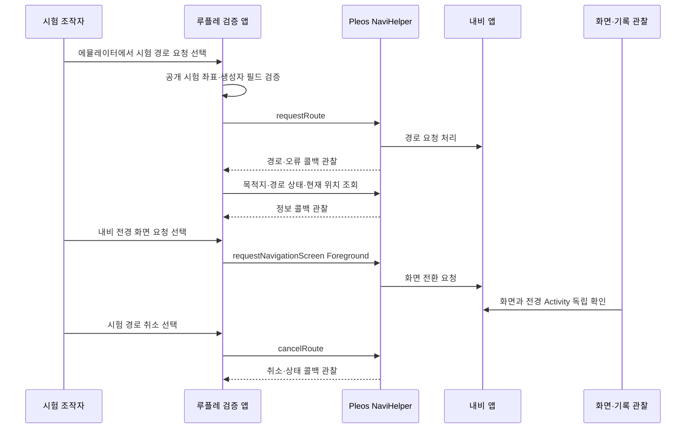

# Pleos 내비 실행 검증

루플레 검증 앱에서 SDK로 시험 경로를 요청해 완료 신호·목적지 반영·내비 전경 표시·취소를 확인했습니다. 완료 신호는 구형 `onRouteEnded`로 수신했고, 새 이름인 `onRoutingCompleted`는 관찰하지 못했습니다. 목적지 이름·식별자는 시험 입력과 일치했지만 좌표는 달랐습니다. 내비 앱 UI에서 직접 목적지를 지정했던 [이전 조회 시험](pleos-nav-probe-results.md)과 구분합니다.

- 분류·목적: 프로젝트. 상세 루틴 로직에 앞서 차량 앱의 내비 실행 입출력 경계 검증
- 요청 근거: 2026년 10월 26일, 에뮬레이터에서 내비 요청·실행 결과 확인 요청
- 범위: NaviHelper 경로 요청·취소, 목적지·경로 상태·현재 위치 조회, 내비 전경 화면 요청과 관찰
- 범위 밖: 일반 차량 제어, 실차, 실제 방문 판정, 장주기 학습, 서버·스마트폰 통합
- 구현 위치: 기존 최소 검증 프로젝트 안의 독립 내비 실행 Activity. 기존 두 목록 조회 모드는 유지
- 상태: 에뮬레이터 실행 검증 수행. 제약과 미검증 범위는 아래 기록
- 진민 확인: 검증 범위 요청은 사용자 지정. 아래 검증 결과·해석은 확인 전
- 결과 근거: [SDK·앱 이벤트 요약](results/pleos-navigation-execution-2026-10-26.json), [전경 화면 전환 요약](results/pleos-navigation-screen-2026-10-26.json)
- 환경 근거: [시험 후 재확인한 패키지 버전·권한](results/pleos-navigation-runtime-2026-10-26.json). SDK 호출 없이 별도 확인한 기록

## 실행 전 검증 기준

요청 함수가 예외 없이 돌아온 사실과 경로 탐색 완료, 목적지 반영, 내비 화면 표시를 구분합니다. SDK 콜백에 이 시험의 요청 식별자가 없으므로 콜백 수신 시점의 시험 단계를 기록하고 요청별 확정 응답이라고 과장하지 않습니다.



시험 대상은 공식 목적지 가이드의 공개 42dot 예제입니다. 실차에서는 실행하지 않도록 개발용 에뮬레이터 조건을 확인하고, 앱 시작만으로 경로를 변경하지 않습니다. 조작자가 시험 버튼을 선택했을 때만 요청합니다. 이는 제품의 실제 사용자 승인 기능을 구현했다는 뜻이 아닙니다.

## 실행 환경과 결과

최종 실행은 `20261026T075534Z-nav-execution-final`입니다. 앱 0.2.1, NaviHelper 3.0.5, navi-data 3.0.4, 내비 서비스 3.0.4, 내비 앱 3.3.2-rc5-hotfix.3, Pleos Connect 2.1.0/API 34의 같은 가상 기기를 사용했습니다. 상세 호스트 환경은 [이전 검증 기록](pleos-nav-probe-results.md)의 환경과 같습니다.

`NAVI_ROUTE`, `NAVI_ROUTE_SEARCH`, `NAVI_CUSTOM_MAP`이 실제 앱 권한에서 granted 상태임을 확인했습니다. 앱의 인터넷 권한·일반 차량 제어 권한은 추가하지 않았습니다. 계정별 프로젝트 승인 상태나 실차 권한을 확인한 것으로 확대하지 않습니다.

| 검사 항목 | 실제 관찰 | 판정·한계 |
| --- | --- | --- |
| 시작 상태 | 목적지 이름·식별자 비어 있음, `SAFE_GUIDING` | 이전 경로가 남아 있는 상태를 새 성공으로 해석하지 않음 |
| SDK 경로 요청 | 버튼 선택 후 `requestRoute` 호출·반환, 경로 시작 콜백 수신 | 공개 시험 인자와 현재 생성자의 getter 대응을 호출 전에 확인 |
| 경로 탐색 완료 | `onRouteEnded` 수신. `onRoutingCompleted` 미수신 | 공식 배포 소스는 두 메서드를 탐색 완료로 정의하고 구형 이름을 deprecated 처리. 이벤트 이름은 합치지 않고 기록 |
| 목적지 반영 | 조회 결과의 장소명·관심 장소 식별자(POI ID)가 시험 입력과 일치 | 위도·경도는 정확히 일치하지 않음. 보정·변환 등 차이의 원인은 미확인 |
| 안내 상태 | `ROUTE_DRIVE`, `ROUTE_GUIDING` 수신 | 실제 주행·도착을 뜻하지 않음 |
| 내비 전경 요청 | `requestNavigationScreen(Foreground)` 반환 후 전경 Activity·화면 변화 확인 | 요청 반환만으로 화면 성공을 판정하지 않음. 아래 독립 관찰과 연결 |
| 시험 경로 취소 | 취소 콜백, 빈 목적지, `SAFE_GUIDING`·`FREE_DRIVE` 수신 | 이번 시험 경로를 정리한 결과이며 모든 취소 상황을 검증한 것은 아님 |
| 종료 | 관찰 종료 후 SDK 해제 호출 기록 수신 | 수집기에서도 종료·해제를 확인 |

0.2.0 예비 실행에서는 새 이름의 완료 콜백만 수집했으므로 완료 신호를 확인하지 못했습니다. 공개 리스너의 구형 메서드도 추가 관찰한 0.2.1에서 `onRouteEnded`를 받았고, [공식 배포 소스](https://nexus-playground.pleos.ai/repository/maven-releases/ai/pleos/playground/NaviHelper/3.0.5/NaviHelper-3.0.5-sources.jar)의 공개 리스너 설명과 deprecated 안내를 대조했습니다. 이를 도착 콜백이나 안내 종료로 바꿔 해석하지 않습니다.

### 화면의 독립 관찰

SDK 화면 요청 직전에 전경 앱 영역은 `com.ruple.probe/.NavigationProbeActivity`였고, 요청 뒤에는 `ai.umos.maps.android.navigation.app/.MainActivity`로 바뀌었습니다. 요청 전후 Activity 덤프를 저장하고 스크린샷에서 42dot 안내 화면을 직접 확인했습니다. 이 구간에서 내비 앱을 `am start`로 직접 실행하지 않았습니다.

[전환 요약](results/pleos-navigation-screen-2026-10-26.json)은 기대한 두 컴포넌트의 전경 여부와 화면 파일의 해시만 포함합니다. 생성 스크립트는 Activity 전환을 검사하며, 스크린샷 내용 자체를 자동 판독하는 도구는 아닙니다. 원본 화면은 `local-artifacts/pleos-nav-probe/`에 유지합니다.

### 추가로 확보한 데이터

| 조회·관찰 | 실제 수신한 정보 | 활용 전 확인할 사항 |
| --- | --- | --- |
| `getDestinationInfo` | 목적지 이름·주소·식별자·좌표, 남은 거리·시간·통행료 필드 | 단위·갱신 주기·신선도, 등록 장소 좌표와 내비 목적지 좌표의 차이 |
| `getRouteStateInfo` | 안내 모드, 경로 옵션, 탐색 상태, 교통 상태 객체 | `trafficStatusRaw`는 SDK 객체의 문자열 표현이며 원본 전송 JSON이 아님. 현재 경로의 정보로 관찰했으며 전체 지역 교통 API를 확보했다는 뜻은 아님 |
| `getCurrentLocationInfo` | 위도·경도·방향·주소·경로 식별자·경로 인덱스 | 실제 차량의 위치 정확도·갱신·백그라운드 수집 지원은 별도 검증 |
| 창이 사라진 동안의 이벤트 | Activity pause 뒤 경로 시작·구형 완료·안내 상태·경로 상태 콜백 수신 | 이 프로세스가 살아 있던 한 사례. 프로세스 종료 뒤 수집·자동 시작·원격 기동을 보장하지 않음 |

`isRouting`이 false인 동시에 `ROUTE_GUIDING`이 반환됐습니다. `isRouting`만으로 안내 활성·종료를 판단하는 규칙을 만들지 않습니다. 관찰 시각도 방문 시각으로 대체하지 않습니다.

## 수집·검증 신뢰도

독립 검토에서 이전 원본을 한 번 확보한 뒤 읽기가 실패해도 과거 자료로 정상 종료할 수 있는 문제가 발견돼 수집기를 보완했습니다. 마지막 정상 수집 시각·오류·종료 사유·SDK 해제 관찰을 `collection`에 남기고, 연속 읽기 실패·세션 변경은 별도 종료 코드로 구분합니다. 호스트 검사는 실제 SDK 실패를 유발한 검증과 구분합니다.

최종 실행은 `expected_events_observed`로 종료했고 정상 스냅샷의 연속 수집과 SDK 해제를 확인했습니다. 앱 시작 직후 세션 포인터를 찾지 못한 읽기 오류가 기록됐으며 이후 정상 수집으로 복구했습니다. 이를 SDK 오류로 집계하지 않습니다. 원본과 공개 요약의 개수·시점은 저장소의 요약 스크립트로 다시 산출할 수 있습니다.

빌드·`lintDebug`와 호스트 검사를 통과했습니다. 최소 검증 앱의 최신 API·의존성·방향·백업 선언·아이콘 관련 비차단 경고와 구형 콜백의 deprecated 표시는 배포 준비 완료로 해석하지 않습니다.

## 확보한 범위와 남은 질문

현재 에뮬레이터에서 확인한 제어 범위는 **내비 경로 요청·취소와 내비 전경 화면 요청**입니다. 위치·목적지·경로 상태를 읽고 실행 결과를 구분할 근거도 추가 확보했습니다. M5의 내비 실행 연계와 M1 입력을 상세화할 근거이며, 서버·스마트폰·루틴 엔진까지 연결된 제품 구현은 아닙니다.

- 🚧 신규·구형 완료 콜백의 버전별 전달·동시 수신과 완료 처리 중복 방지
- 🚧 요청·반환 목적지 좌표 차이의 원인과 장소 식별 정책
- 🚧 실제 도착 이벤트, 이동 시 위치 갱신과 반복 근거 축적
- 🚧 앱 프로세스 종료·재생성·부팅·네트워크 중단 후 동작
- 🚧 SDK 오류·권한 거부·화면 요청 실패의 실제 재현
- 🚧 실차, 일반 차량 제어, 마이현대 연계, 에너지 관리·자율주행 권한

## 재현·요약 생성

앱 실행과 버튼 순서는 [검증 앱 안내](../../prototypes/pleos-nav-probe/README.md)의 내비 모드를 따릅니다. 최종 시험은 시작 시 경로가 없는 상태에서 요청·상태 조회·전경 화면 요청·취소·관찰 종료 순으로 수행했습니다.

```sh
python3 prototypes/pleos-nav-probe/scripts/publish_summary.py \
  local-artifacts/pleos-nav-probe/20261026T075534Z-nav-execution-final \
  --output docs/research/results/pleos-navigation-execution-2026-10-26.json

python3 prototypes/pleos-nav-probe/scripts/summarize_screen_transition.py \
  --before-activities local-artifacts/pleos-nav-probe/nav-final-before-screen-activities.txt \
  --after-activities local-artifacts/pleos-nav-probe/nav-final-after-screen-activities.txt \
  --before-screen local-artifacts/pleos-nav-probe/nav-final-before-screen.png \
  --after-screen local-artifacts/pleos-nav-probe/nav-final-after-screen.png \
  --output docs/research/results/pleos-navigation-screen-2026-10-26.json

python3 prototypes/pleos-nav-probe/scripts/capture_runtime_metadata.py \
  --serial emulator-5554 \
  --output docs/research/results/pleos-navigation-runtime-2026-10-26.json
```

## 공식 근거

- [목적지 요청·조회·취소](https://document.pleos.ai/en/docs/pleos-only/connect-sdk-pleos/NaviHelper/destinations)
- [조회·경로·화면 권한](https://document.pleos.ai/en/docs/pleos-only/connect-sdk-pleos/NaviHelper/declaring-permissions)
- [내비 이벤트](https://document.pleos.ai/en/docs/pleos-only/connect-sdk-pleos/NaviHelper/event-listeners)
- [NaviHelper 3.0.5 공식 배포 소스](https://nexus-playground.pleos.ai/repository/maven-releases/ai/pleos/playground/NaviHelper/3.0.5/NaviHelper-3.0.5-sources.jar)

SDK·에뮬레이터 버전과 원본·요약·화면 관찰을 연결했습니다. 원본 위치와 기기 로그는 Git 제외 경로에 유지합니다.
