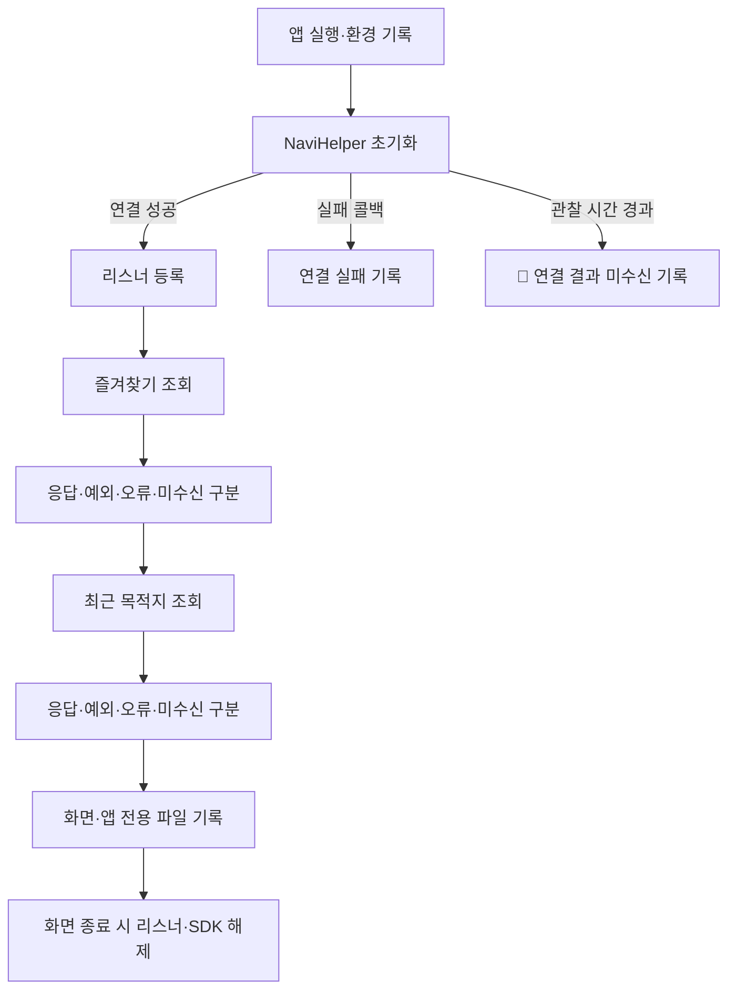

# Pleos 내비 조회·실행 검증 앱

즐겨찾기·최근 목적지 조회와 별도 내비 실행을 확인하는 개발용 앱입니다. [데이터 대응표](../../docs/research/pleos-data-api-matrix.md)의 입력·실행 미검증 항목을 확인하며, 루틴 기능이나 제품 앱의 기술 스택을 확정하지 않습니다.

- 요청 근거: 2026년 10월 26일, Pleos 에뮬레이터 구성과 두 조회 API의 실제 반환 확인 요청
- 두 목록 조회 모드: `MainActivity`. SDK 초기화·리스너 등록, `getBookmarkInfo()`, `getRecentDestinationInfo()`, 응답·오류·미수신 관찰, 해제
- 내비 실행 모드: `NavigationProbeActivity`. 조작자가 선택한 경로 요청·취소·전경 화면 요청, 목적지·경로 상태·현재 위치 조회와 이벤트 기록
- 앱 권한: 조회 `NAVI_ROUTE`, 경로 요청·취소 `NAVI_ROUTE_SEARCH`, 전경 화면 요청 `NAVI_CUSTOM_MAP`. 모두 `pleos.car.permission.` 접두어 사용
- 결과 구분: 연결 실패, 요청 예외, SDK 오류 이벤트, 빈 목록, 값이 있는 목록, 관찰 시간 내 콜백 미수신
- 🚧 실차 지원·실차 이력·내비 데이터 생성 조건은 에뮬레이터 결과와 별도 검증

## 실행 흐름

구현 전 기준입니다. SDK 콜백에는 이 앱의 요청 식별자가 없으므로 요청과 이벤트의 대응을 확정하지 않습니다. 두 종류를 순서대로 요청하고 요청·수신 시각을 각각 남깁니다.



미수신을 빈 목록으로 만들지 않습니다. 늦게 도착한 이벤트는 별도로 기록합니다. 위 흐름은 두 목록 조회 모드이며, 경로 요청은 아래 별도 내비 실행 모드에서만 조작자가 선택합니다. 시험 자료 자동 대체, 일반 차량 하드웨어 제어, 서버 전송은 구현하지 않습니다.

## 개발 환경과 재현

이 프로젝트는 Java 기반 Android 검증 앱입니다. 제품 앱·스마트폰·서버의 기술 스택 결정과 구분합니다.

| 구성 | 사용 버전·조건 |
| --- | --- |
| 호스트 | macOS, Apple Silicon |
| Java | 21 |
| Gradle Wrapper / Android Gradle Plugin | 8.14.3 / 8.13.2 |
| 컴파일 SDK / Build Tools | Android 35 / 35.0.0 |
| 앱 최소 / 대상 SDK | 28 / 34 |
| NaviHelper / 전이 의존성 navi-data | 3.0.5 / 3.0.4 |
| 현재 검증 앱 버전 | 0.2.1 |
| 가상 기기 | Pleos Connect 2.1.0, Android 34, arm64-v8a, RAM 4096 MB, Cold Boot |

Android Studio와 SDK·에뮬레이터는 [공식 설치 가이드](https://document.pleos.ai/en/docs/connect/guide/getting-started/application-development/setup-connect-sdk-emulator)를 기준으로 구성합니다. 이 Mac에서는 SDK를 사용자 기본 경로에 설치하고 공식 ARM64 이미지의 크기·체크섬을 확인한 뒤 CLI로 등록했습니다. 구체 버전·이미지 출처·관찰 결과는 [실행 검증 결과](../../docs/research/pleos-nav-probe-results.md)에 기록합니다.

저장소 루트에서 실행합니다.

```sh
export ANDROID_HOME="$HOME/Library/Android/sdk"
export JAVA_HOME="$(/usr/libexec/java_home -v 21)"
printf 'sdk.dir=%s\n' "$ANDROID_HOME" > prototypes/pleos-nav-probe/local.properties
cd prototypes/pleos-nav-probe
./gradlew :app:assembleDebug :app:lintDebug
```

다른 터미널에서 가상 기기를 실행합니다. 이 이름은 현재 Mac에 생성한 가상 기기 이름입니다. 다른 환경에서는 `emulator -list-avds`로 확인합니다.

```sh
"$HOME/Library/Android/sdk/emulator/emulator" \
  -avd Ruple_Pleos_2_1 -no-snapshot -memory 4096 -gpu host -port 5554
```

부팅 완료 후 저장소 루트에서 수집합니다. 실행 중인 다른 가상 기기가 있으면 일련번호를 명시해 선택합니다.

```sh
"$HOME/Library/Android/sdk/platform-tools/adb" devices -l
python3 prototypes/pleos-nav-probe/scripts/capture_probe.py \
  --serial emulator-5554 --label manual-check --seconds 100
```

수집기는 가상 기기 여부·부팅·현재 Android 사용자 ID를 확인한 뒤 해당 사용자에게 앱을 설치·실행하고 로그를 읽습니다. 차량용 Android에서는 시스템 사용자 0과 현재 사용자 10이 다를 수 있습니다. 실차는 이 수집기로 실행하지 않습니다.

앱 실행 시 두 종류를 자동으로 조회하고, 상단에 수신 상태를 표시합니다. `두 항목 다시 조회` 버튼으로 재조회할 수 있습니다. 각 요청의 콜백 관찰 시간은 30초이며, 수신 실패를 뜻하는 SDK 공인 시간 제한은 아닙니다. 수집기의 최대 관찰 시간은 `--seconds`로 지정합니다. 두 응답이 정상 수신되면 조기에 수집을 마치고, 미수신이 있으면 늦은 이벤트를 추가로 관찰합니다.

원본은 앱의 백업 제외 전용 디렉터리 `no_backup/`와 저장소의 `local-artifacts/` 아래에만 두며 Git에서 제외합니다. 앱의 인터넷 권한·원본 Logcat 출력·서버 업로드 기능은 없습니다. 화면과 JSON은 SDK의 타입 객체를 앱이 공개 getter로 직렬화한 결과이며, 내비 서비스의 원본 전송 형식을 뜻하지 않습니다.

내비 모드는 SDK 콜백·앱의 호출 기록·조작자 선택·생명주기를 출처별로 구분합니다. SDK에 전달한 공개 시험 입력을 SDK가 반환한 데이터라고 표시하지 않습니다.

수집 폴더에는 환경·원본 JSONL·요약 JSON이 생성됩니다. 요약은 다음 명령으로 다시 산출할 수 있습니다. 요약에 장소명·주소·좌표값을 포함하지 않습니다.

```sh
python3 prototypes/pleos-nav-probe/scripts/summarize_probe.py \
  local-artifacts/pleos-nav-probe/해당-실행/events.jsonl
```

검증 실행은 1차 제품 전체의 완료를 뜻하지 않습니다. 시험 장소 등록·목적지 지정과 실제 방문도 구분합니다.

## 내비 실행 모드

[내비 실행 검증 결과](../../docs/research/pleos-navigation-execution.md)에서 실제 이벤트와 화면 관찰을 확인할 수 있습니다. 아래 명령은 앱을 설치·실행하고 기록만 수집합니다. 앱 시작 시 경로를 바꾸지 않습니다.

```sh
python3 prototypes/pleos-nav-probe/scripts/capture_probe.py \
  --serial emulator-5554 --probe navigation --label nav-check --seconds 600
```

앱에서 `42dot 경로 요청`을 선택한 뒤 `상태 조회`로 확인하고, `내비 화면` 버튼으로 전경 전환을 요청합니다. 내비가 표시된 상태에서 검증 앱으로 돌아오려면 다음 명령을 사용할 수 있습니다. 내비 앱을 직접 실행하는 명령과 구분합니다.

```sh
"$HOME/Library/Android/sdk/platform-tools/adb" -s emulator-5554 shell am start \
  --user 10 -f 0x20020000 -n com.ruple.probe/.NavigationProbeActivity
```

사용자 ID `10`은 이번 환경의 값입니다. 다른 환경에서는 `am get-current-user`로 확인합니다. 마무리할 때 `시험 경로 취소`를 선택하고, 다시 검증 앱에서 `관찰 종료·SDK 해제`를 선택합니다. 앱은 개발용 `ranchu`·`crp_avd_arm64` 환경에서만 내비 조작을 허용합니다.

수집기는 종료 사유·마지막 정상 수집 시각·읽기 오류·SDK 해제 관찰 여부를 `collection`에 기록합니다. 자료 확보 후 연속 읽기 실패 또는 세션 변경은 종료 코드 2로 구분합니다. 관찰 제한시간 종료는 `observation_timeout`이며 앱·SDK가 종료됐다는 뜻이 아닙니다. 명령의 종료 코드 0도 내비 실행 성공 판정이 아닙니다.

수집기의 조기 종료·실패 대기·늦은 이벤트 구분과 공개 요약의 값 제거는 호스트에서 확인합니다. 이 검사는 SDK의 실패 상황을 실제로 유발한 검증과 구분합니다.

```sh
python3 -m unittest discover -s prototypes/pleos-nav-probe/tests -v
```

## 공식 근거

- [NaviHelper 가져오기](https://document.pleos.ai/en/docs/pleos-only/connect-sdk-pleos/NaviHelper/importing-sdk)
- [연결·해제](https://document.pleos.ai/en/docs/pleos-only/connect-sdk-pleos/NaviHelper/initialization-and-release)
- [이벤트](https://document.pleos.ai/en/docs/pleos-only/connect-sdk-pleos/NaviHelper/event-listeners)
- [권한](https://document.pleos.ai/en/docs/pleos-only/connect-sdk-pleos/NaviHelper/declaring-permissions)
- [에뮬레이터 구성](https://document.pleos.ai/en/docs/connect/guide/getting-started/application-development/setup-connect-sdk-emulator)
